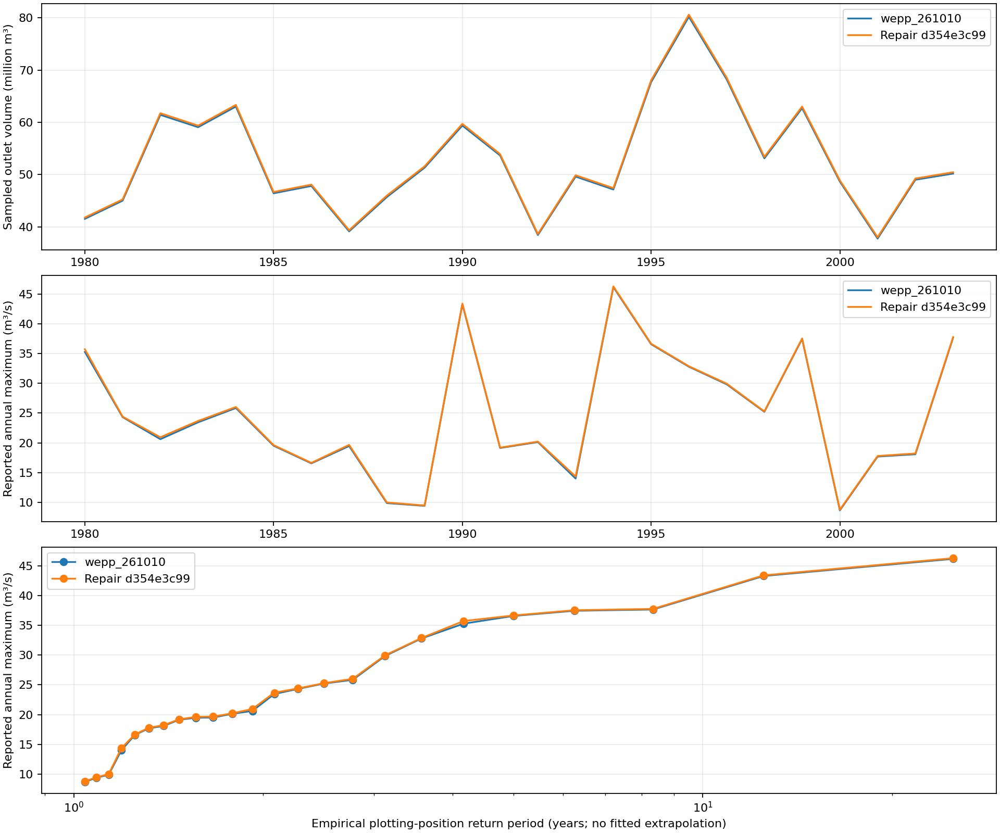
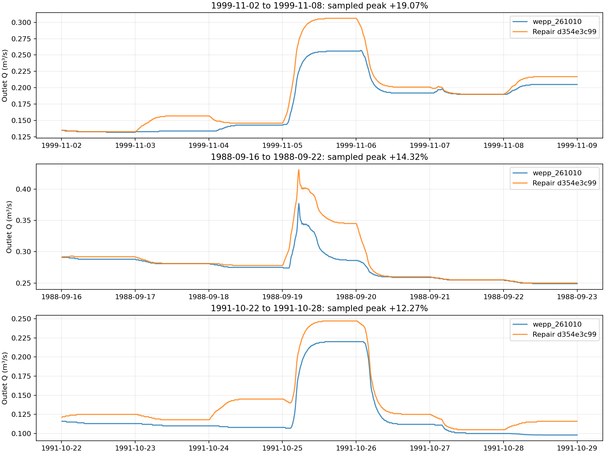

# Cedar Creek: repaired build versus wepp_261010

The full 1980–2003 Cedar Creek comparison completes successfully. Relative to
`wepp_261010`, the unreleased repair increases sampled outlet discharge volume
**0.5165%** and the largest reported peak **0.2455%**. Annual flood peaks change
modestly, but several low-flow event windows change materially. This is an
end-to-end build comparison: hourly hillslope allocation changes are included,
so outlet differences cannot be attributed solely to channel routing.

## Full-record results

| Measure | wepp_261010 | Repair d354e3c99 | Change |
| --- | ---: | ---: | ---: |
| Sampled outlet volume, million m³ | 1266.461660 | 1273.003350 | +0.5165% |
| Mean sampled outlet discharge, m³/s | 1.672156 | 1.680793 | +0.5165% |
| Reported outlet volume, million m³ | 1272.337712 | 1273.001266 | +0.0522% |
| Largest reported peak, m³/s | 46.19911 | 46.31255 | +0.2455% |
| Aggregated hillslope yield, million m³ | 1267.735666 | 1268.205085 | +0.0370% |

The largest sampled peak occurs at **October 27, 1994, 04:40** in both runs.
Annual sampled outlet volumes increase **0.4586–0.6535%**. All 24 annual maximum
reported flows increase, by **0.2229–2.4612%**; the largest relative annual-peak
change is 1993, from 13.99191 to 14.33628 m³/s. Annual peak curves remain close,
with no change to the largest event's sampled peak time.

## Event behavior

The October 24–30, 1994 window gains 0.7817% in sampled volume. Its sampled peak
changes 46.2 to 46.3 m³/s, with unchanged first-maximum time and a +2.42-minute
flow-centroid change. The April 1990 and March 2003 large-event windows gain
0.4975% and 0.5654% in volume; their first sampled peak times also remain equal.

The symmetric screen covers 356 overlapping seven-day windows selected from
both builds' daily peaks and the largest daily peak changes. Among these windows,
volume increases range 0.0784–13.5525%; sampled peak changes range 0–19.0661%.
These windows are descriptive comparisons, not independent storm delineations.

| Window | Reference sampled peak, m³/s | Repair sampled peak, m³/s | Peak change | Volume change |
| --- | ---: | ---: | ---: | ---: |
| November 2–8, 1999 | 0.257 | 0.306 | +19.07% | +7.76% |
| September 16–22, 1988 | 0.377 | 0.431 | +14.32% | +3.54% |
| October 22–28, 1991 | 0.220 | 0.247 | +12.27% | +13.55% |

The low-flow plots show changes in sustained levels and recession as well as
crest magnitude. They should not be dismissed by the small full-record or
annual-flood percentages. In the November 1999 window, the repaired maximum
has 62 tied printed samples; its much earlier first-maximum selection is not
evidence of an equivalent hydrograph translation. Window-centroid changes range
−73.33 to +11.90 minutes and do not establish individual-storm travel times.
First-maximum selections across all windows span −2,680 to +4,680 minutes;
competing or tied rounded crests can change which maximum wins. These selections
must not be presented as calendar shifts or a translation of the entire event.

[Large-event and retained 1991 hydrographs](cedar-comparison/event-hydrographs.png).

## Discharge publication and water accounting

The release's sampled hydrograph sum is **5,876,051.92 m³ below** its published
outlet volume. The repaired difference is **+2,084.47 m³**. Right-endpoint sums
omit q(0) and use three-significant-figure printed rates; they are not exact
solver integrals. The conservative full-record printing bounds are 2.878 and
2.887 million m³ respectively.

Using the preceding day's endpoint to reconstruct daily trapezoidal integrals,
**0 of 8,765 checkable repaired days** exceed the conservative printing bound,
versus **3,446 reference days**. Day one is excluded because its initial q(0)
is not printed. This supports the repaired discharge-publication contract;
it does not establish physical channel storage or signed soil/routing closure.
Reported candidate peaks include q(0); positive-time sampled peaks can omit it.
The annual-peak table and annual plot therefore use the reported peak values.

Aggregated hillslope yield increases 469,419.61 m³: surface runoff +64,148.87,
lateral flow +153,829.12, and modeled baseflow +251,441.63 m³. This is the standard
PASS/WAT aggregation with groundwater settings 0 mm, 0.04/day and zero deep
seepage; it is not a direct measurement of channel-admitted flux. It cannot by
itself explain the 6,541,690.50 m³ sampled outlet increase. Causal allocation
among the source, routing and publication repairs requires separate ablations.
The broader signed-exchange acceptance question remains open.

## Execution and provenance

Cedar Creek is `warming-championship`, using the retained 10 cm RRINIT snapshot
at `/workdir/warming-rrinit-20261006/snapshot`: 864 hillslopes, 1,904 OFEs,
371 channels and 8,766 days. Empty `wepp_ui.txt` enables hourly soil balance;
WAT headers confirm it. Routing is MC4 on a 600-second grid. Both lanes preserve
all physical inputs; only `chan.inp` output selection changes from 1 to 3 to save
the full outlet hydrograph, matching prior Cedar comparisons. No live project
inputs were modified.

`wepp_2601010` in the request is interpreted as the available `wepp_261010`.
The reference pair matches its release sidecar hashes. Candidate binaries match
the previously validated receipt and all 242 Fortran source units match native
`d354e3c998f81955f9d9e5ca7d01ca56e1a9f04b`. Both lanes generated fresh same-build
PASS files: all 1,728 hillslope simulations and both 24-year watershed runs passed.
Each outlet contains 1,262,304 finite nonnegative samples with every date and
600-second time checked. Each fresh conversion accepts 7,573,824 PASS and
16,690,464 WAT rows with zero rejected records. The source snapshot manifest remains
unchanged and both lanes consume equal input manifests. The comparison is supplementary validation, not field calibration
or release authorization.

Reproduce with `run_cedar_comparison.py`, then `analyze_cedar_comparison.py` in
this package, using the WEPPpy virtualenv and `PYTHONPATH=/home/workdir/wepppy`.
Both scripts require their output directory not to exist. The retained raw root
is `/workdir/cedar-physical-water-comparison-20261021`; the first analysis is
retained there as `analysis-v1`. The final revision changes plots only. Numerical
results were independently recomputed from the native outlet files.

[Independent scientific review](cedar-comparison-scientific-review.md) ·
[Summary](cedar-comparison/summary.json) · [Annual results](cedar-comparison/annual.csv)
· [Event windows](cedar-comparison/events.csv) · [Artifact hashes](cedar-comparison/manifest.json).
