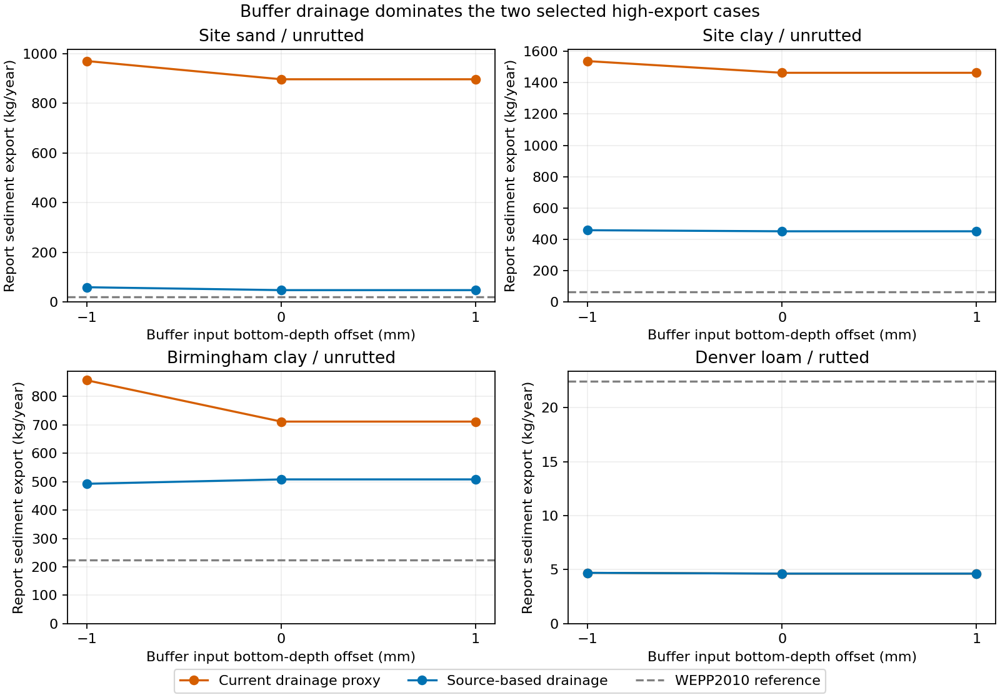

# Roads buffer drainage and storage results

**Buffer lower-boundary conductivity is the dominant tested driver of the two
selected high sediment exports.** At unchanged input depth, replacing the existing
bedrock-proxy conductivity with the unattenuated source conductivity reduces site
sand export by 94.7% and site clay by 69.2%. Both move inside the factor-ten band
relative to FSWEPP/WEPP2010. Erosion coefficients, road/fill inputs, climate,
geometry, management and the 200 mm boundary remain fixed.

This is a successful diagnostic experiment, not acceptance of a new production
lower-boundary rule. The source conductivities are not independently validated
bedrock drainage measurements. No production code, defaults or binaries changed.

## Frozen experiment

Start from the preceding experimental bare-road/bare-fill/forest-buffer preparation.
“Current drainage” means those frozen inputs, not a newly deployed Roads treatment.

Four profiles × two buffer drainage conductivities × three final-depth offsets:
**24 completed native runs**, each covering 16 years. Initial soil saturation is
0.75 in all cases. Only buffer `res_lyr.kslast` and final horizon `solthk` change;
all other properties and boundaries are preserved.

| Specimen | Current kslast, mm/h | Alternative, mm/h | Basis |
|---|---:|---:|---|
| Site sand | 0.00151 | 1.512 | Frozen restrictive-layer provenance: 0.42 um/s × 3.6 |
| Site/Birmingham clay | 0.00328 | 3.276 | Frozen restrictive-layer provenance: 0.91 um/s × 3.6 |
| Denver loam | 0.01 | 59.8734 | Deepest emitted horizon Ksat; no identified restriction |

The loam alternative is a no-throttle counterfactual, not measured bedrock Ksat.
The current `/1000` reduction is a documented historical proxy, not a newly proven
unit error. Sand identifies lithic bedrock; clay's restriction type is N/A.
These distinctions matter for any later physical parameterization decision.

Depth offsets are −1, 0 and +1 mm relative to each current bottom. Exact-release
`input.for` adds 200 mm to the final depth, caps it at 1800 mm, then selects whole
200 mm computational layers. Hence 399/400/401 mm inputs yield 400/600/600 mm
computational profiles; loam 1599/1600/1601 yields 1600/1800/1800 mm.
All 24 WAT depth readbacks confirm that prediction.

All four current-drainage, zero-offset controls reproduce the preceding study's
seven native output files byte-for-byte. All eight zero/+1 mm pairs also produce
identical native outputs. This is direct evidence of the discretization threshold,
not a proposal to subtract 1 mm from generated soils.

## Sediment and comparison target

Annual report sediment exports in kg/year, at unchanged input depth:

| Profile | WEPP2010 reference | Current drainage | Alternative drainage | Alternative/reference |
|---|---:|---:|---:|---:|
| Site sand, unrutted gravel/high | 20.22 | 897.41 | **47.33** | **2.34×** |
| Site clay, unrutted paved/high | 65.52 | 1,463.47 | **450.97** | **6.88×** |
| Birmingham clay, unrutted paved/low | 223.76 | 711.58 | 507.95 | 2.27× |
| Denver loam, rutted gravel/low | 22.48 | 4.63 | 4.63 | 0.21× |

All **12/12 alternative-drainage cases**, including all three depth offsets,
meet the 0.1–10× target; current drainage meets it in 6/12. These are selected
case counts, not independent validation or an estimate of broader matrix success.
The retained WEPP2010 controls have matching climate, management, geometry and
run prompts; their inputs and outputs were rehashed before comparison.

At the −1 mm depth offset, current-drainage exports become 970.90, 1,538.12,
856.98 and 4.70 kg/year respectively. Smaller computational storage therefore
increases all four current-drainage exports, and does not resolve the two outliers.
With alternative drainage those exports are 59.01, 457.78, 492.43 and 4.70 kg/year.
The interaction is not universally monotonic: Birmingham's lower-storage alternative
has slightly less export than its unchanged-depth alternative.

## Water partition and net sediment exchange

The following comparisons hold buffer input depth fixed. Water volumes are
m³/year; sediment values are signed buffer net exchange in kg/year. Negative
exchange means net retention, not zero gross erosion.

| Site buffer quantity | Sand current | Sand alternative | Clay current | Clay alternative |
|---|---:|---:|---:|---:|
| Surface inflow from fill | 396.74 | 396.74 | 436.45 | 436.45 |
| Surface outflow | 2,352.03 | 103.57 | 2,535.55 | 387.53 |
| Deep percolation | 30.48 | 3,170.14 | 61.38 | 2,729.44 |
| Lateral outflow | 607.44 | 20.82 | 386.34 | 38.33 |
| Buffer net sediment exchange | +733.23 | **−127.99** | +941.77 | **−69.99** |
| Days at ≥90% reported pore capacity | 2,669 | 46 | 2,883 | 294 |

Near-capacity days are a descriptive proxy using WAT SoilWaterTotal and
ProfilePorosityCap, not a new model threshold or proof of runoff mechanism.
The large changes in drainage, storage and surface outflow support a hydrologic
explanation for the net-source-to-net-sink transition. They do not establish the
physical correctness of the alternative lower-boundary conductivity.

The effect is not confined to initial storage. Excluding year one, sand export
changes from 947.60 to 50.50 kg/year; clay from 1,546.16 to 478.48 kg/year.
These are matched years 2–16 contrasts, not a newly selected warm-up prescription.
Annual water and export series are retained in the complete results.

Birmingham also remains inside the target: deep percolation rises from 36.02 to
432.21 m³/year, surface outflow falls from 237.87 to 84.59, and the buffer becomes
a stronger net sink (−76.64 to −282.47 kg/year). Denver's sediment and surface
outflow are unchanged by drainage at fixed depth; deep percolation rises only
from 1.03 to 3.69 m³/year. The dry loam counterexample was preserved.

## Upstream coupling and accounting limits

The initial exact upstream-output check **failed** and its analysis directory is
retained. Inputs are invariant in all 24 cases, but upstream outputs are exactly
invariant in only 10/24. The final analysis records every nonzero difference;
no tolerance was introduced to relabel changed outputs as invariant.

For the two site cases, alternative drainage at unchanged depth changes mean
surface inflow from fill by less than 0.000001 m³/year. Nevertheless, upstream
sediment changes: sand's fill-exit boundary export increases by 11.19 kg/year;
clay's decreases by 0.75 kg/year. The large total-export response remains dominated
by the change in buffer net exchange, but it is not a perfectly independent
buffer-output substitution.

Exact native source has a coupling mechanism: IRS computes effective runoff
duration for an equivalent hydrologic plane, then assigns that duration and
recalculates peak runoff for its member OFEs. These values drive erosion loads.
Thus unchanged upstream input files do not guarantee unchanged upstream sediment.
Upstream water/state changes have not been traced event by event. For the Denver
−1 mm treatment, maximum fill differences reach 0.384 mm in WAT Q and 5.67 mm
in SoilWaterTotal; do not dismiss all coupling as printed rounding or claim the
source audit explains every event.
See [source audit](artifacts/source-audit.md) and
[full coupling diagnostics](artifacts/upstream-coupling.json).

All **24/24 terminal ELEMENT/annual report budgets reconcile** within the unchanged
printed-precision bounds, with **zero beyond-precision EBE discrepancies** in this
panel. Full WAT calendars and boundary-transfer checks pass. Independent SQL
aggregation reproduces all 24 sediment and water budgets. Apparent soil balance
still does not claim complete canopy/snow/soil closure; net sediment exchange is
not gross detachment/deposition or particle-origin tracking.

## Disposition and next step

The experiment identifies a concrete candidate assumption to evaluate: applying
the generic restrictive-layer proxy to the natural buffer can keep these generated
profiles wet enough to turn their buffers into major net sediment sources.
Changing road erosion coefficients is not the first warranted response to these cases.

Before a production change, define a physically justified buffer lower-boundary
policy that distinguishes actual lithic restrictions, low-conductivity soil horizons,
and profiles with no identified restriction. Evaluate that policy on the broader
multi-climate matrix and held-out specimens, including wet climates on loam, using
fixed erosion coefficients and declared acceptance criteria. Retain current drainage
as a control and test buffer-only changes separately from any whole-profile change.
Do not simply multiply every generated soil's kslast by 1000.
The paved/high case still uses the frozen bare-role erosion inputs; this experiment
does not validate pavement or traffic response, and the remaining 6.88× difference
should not be interpreted as physical calibration.

A global SSURGO writer change would affect non-road simulations and requires a
separate ADR plus broader hydrologic validation. A Roads-specific treatment would
also need an explicit physical rationale and real-project artifact checks. Neither
is authorized or implemented by this diagnostic package.

## Evidence and reproduction

Retained root: `/wc1/runs/ro/roads-buffer-drainage-20261029`.
Modern binary SHA-256:
`a6351d371030f702be5eb0d727d8e7181eeb9d60e9ddf6ce05d9616e5d759d48`.
The declaration is authoritative for the exact identity.

[Declaration](artifacts/declaration.json), [summary CSV](artifacts/summary.csv),
[complete results](artifacts/results.json), [acceptance counts](artifacts/acceptance.json),
[unchanged-grid controls](artifacts/same-grid-controls.json),
[independent aggregation](artifacts/independent-reaggregation.json),
[validation and commands](artifacts/validation.md), and
[portable hashes](artifacts/portable-sha256.json) retain the executable evidence.
