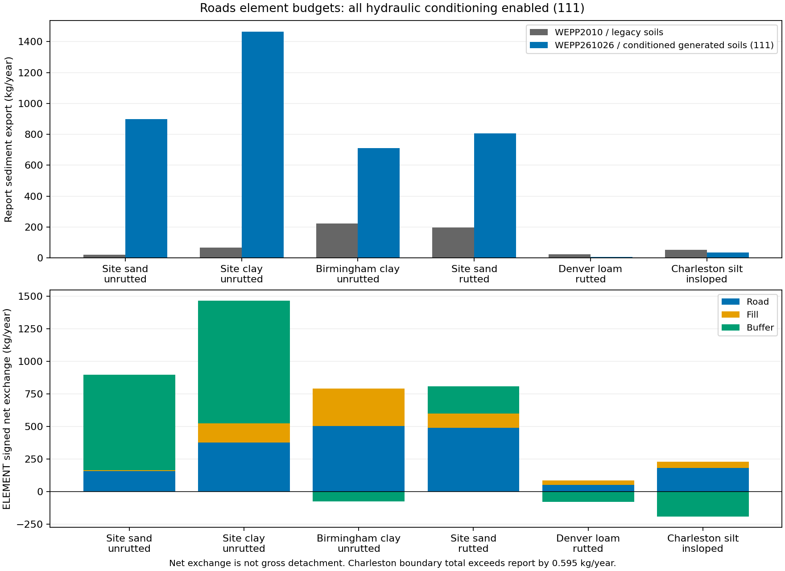

# Roads sediment: element budgets and hydraulic factorial

The 66-run study is complete. Surface hydraulic conditioning alone does not solve
the two selected site-climate unrutted failures. Their buffers are large net
sediment sources, and generated-soil profiles route substantially more water to
surface runoff and much less to deep percolation than the legacy profiles.
The next study should isolate **buffer lower-boundary drainage and profile storage**
before fitting road erosion coefficients.

No production parameters, generated-soil rules, native source, or binaries changed.
The 200 mm normalization remains present throughout the generated-soil experiment.

## Design and reproducibility

Six frozen profiles, each with eight road/fill/buffer hydraulic combinations,
one full format-only 9002 anchor, and legacy-input controls under both WEPP2010
and `wepp_261026`: **66 completed native runs**, each spanning 16 years.
The panel spans four climates and four soil specimens. It is a diagnostic panel,
not a representative sample or independent validation set.

Factor bits are road, fill, buffer. `1` selects the previous role-conditioned
hydraulics; `0` selects format-only hydraulics. Ki, Kr, critical shear, soil landuse
identity, deeper horizons, management, geometry and climate remain fixed across
the factorial. Consequently **`000` retains role-conditioned erosion parameters**;
it is not the separate `format` anchor. All six `111` endpoints reproduce all seven
native output files from the preceding roles confirmation byte-for-byte.

Retained execution root:
`/wc1/runs/ro/roads-ofe-budget-20261029-v2/factorial-v1`.
The exact modern binary SHA-256 is
`a6351d371030f702be5eb0d727d8e7181eeb9d60e9ddf6ce05d9616e5d759d48`.
See [declaration](artifacts/declaration.json), [run hashes](artifacts/run-evidence.json),
[prior reproduction](artifacts/prior-reproduction.json), and
[validation/reproduction commands](artifacts/validation.md).

## Sediment results

All exports below are annual report kg/year. Ratios use fresh WEPP2010 legacy-input
controls, with the same climate and geometry. The target is 0.1–10× for positive
references; zeros remain explicit.

| Profile | WEPP2010 legacy | Modern legacy | Modern `111` | `111` ratio | Factorial export range |
|---|---:|---:|---:|---:|---:|
| Site sand, unrutted gravel/high | 20.22 | 34.53 | 897.41 | 44.39× | 691.58–1,070.82 |
| Site clay, unrutted paved/high | 65.52 | 28.19 | 1,463.47 | 22.34× | 1,357.38–1,639.72 |
| Birmingham clay, unrutted paved/low | 223.76 | 220.22 | 711.58 | 3.18× | 708.26–1,416.44 |
| Site sand, rutted gravel/high | 195.58 | 380.71 | 805.71 | 4.12× | 708.56–805.71 |
| Denver loam, rutted gravel/low | 22.48 | 28.03 | 4.63 | 0.21× | 0–8.34 |
| Charleston silt, insloped vegetated/gravel/low | 51.93 | 65.91 | 34.76 | 0.67× | 3.53–47.84 |

All six modern legacy-input controls meet the factor-ten target. None of the eight
hydraulic combinations meets it for either site-climate unrutted failure:
sand remains 34.2–53.0×; clay remains 20.7–25.0×. Four `111` cases meet the target,
but this selected six-case count is not an estimate of wider matrix performance.

ELEMENT boundary differences reveal where sediment is added or removed. Positive
values below are annual **net addition**, negative values net removal, in kg/year.
They are not gross detachment/deposition or particle-origin fractions.

| `111` profile | Road net | Fill net | Buffer net |
|---|---:|---:|---:|
| Site sand, unrutted | 155.90 | 8.25 | **733.23** |
| Site clay, unrutted | 376.61 | 145.08 | **941.77** |
| Birmingham clay, unrutted | 502.56 | 285.67 | -76.64 |
| Site sand, rutted | 488.48 | 109.84 | 207.39 |
| Denver loam, rutted | 48.71 | 35.13 | -79.21 |
| Charleston silt, insloped | 179.87 | 49.10 | -193.61 |

The two largest selected failures are therefore not explained by road erosion
alone. The buffer is not universally a source: climate, soil and geometry matter.
Charleston's ELEMENT terminal total exceeds the report by 0.595 kg/year; its
source/sink signs are useful diagnostics but do not constitute reconciled export
attribution. The other five `111` terminal budgets meet the printed-precision bound.

## Hydraulic effects and water partitioning

Mean paired export changes when enabling each factor, averaged over all four
settings of the other two factors (kg/year):

| Profile | Road | Fill | Buffer |
|---|---:|---:|---:|
| Site sand, unrutted | +109.77 | -184.92 | +82.22 |
| Site clay, unrutted | +42.53 | +72.86 | -164.48 |
| Birmingham clay, unrutted | -13.94 | +28.02 | -638.95 |
| Site sand, rutted | +23.03 | +27.00 | +37.04 |
| Denver loam, rutted | +5.55 | +0.93 | -2.38 |
| Charleston silt, insloped | +28.59 | +2.23 | -7.20 |

These are paired responses, not universal coefficients. Road conditioning in site
clay ranges from -12.37 to +93.71 kg/year depending on other factors. Birmingham
buffer conditioning reduces export by 578.86–704.86 kg/year. The full pairs and
nonadditivity measures are retained in [effects.json](artifacts/effects.json).
There is no common monotonic hydraulic adjustment that resolves the panel.

The strongest next lead is the buffer water partition. Below, **both columns use
the modern binary**; the comparison is legacy inputs versus generated soils `111`.
Volumes use emitted geometry and the audited cumulative/local depth conventions.

| Site unrutted buffer, m³/year | Legacy sand | Generated sand | Legacy clay | Generated clay |
|---|---:|---:|---:|---:|
| Surface inflow from fill | 88.72 | 396.74 | 290.45 | 436.45 |
| Surface outflow | 51.26 | 2,352.03 | 570.52 | 2,535.55 |
| Deep percolation | 2,459.51 | 30.48 | 2,134.81 | 61.38 |
| Lateral outflow | 5.65 | 607.44 | 29.26 | 386.34 |

The matched unrutted geometry represents a roughly 1,708 m² buffer behind a
241 m² road; the paired rutted buffer is about 157 m². That geometry is shared
with the corresponding legacy control, but it magnifies the consequences of
buffer parameterization and cautions against treating all exported sediment as
road-surface erosion.

In generated sand the buffer adds about 1,955 m³/year of net surface flow; in clay,
about 2,099 m³/year. Even `000` retains large surface outflows (2,152 and 2,696
m³/year) and low deep percolation (30.47 and 61.29 m³/year). The factorial left lower
horizons, restrictive-layer settings and profile storage unchanged, so it cannot
identify which of those causes the partition shift.

The sand specimen carries a restrictive-layer conductivity of 0.00151 mm/h.
The SSURGO writer explicitly applies the historical bedrock-proxy reduction
`(source_um_s * 3.6) / 1000`; this is a documented heuristic, **not a newly proven
unit-conversion bug**. See the
[SSURGO parameterization history](../../../wepppy/soils/ssurgo/ssurgo.md#historical-kslast-parameterization-git-record).
The native source consumes `kslast` in mm/h. Similarity to a generic legacy soil
cannot establish that the generated profile's restrictive layer is physically wrong.

The [profile-depth readback](artifacts/profile-depth-audit.json) also distinguishes
input boundaries from computational storage: generated sand ends at 400 mm but
reports 600 mm in WAT; the legacy sand buffer ends at 300 mm and reports 400 mm.
The clay buffer reports 600 mm for both input families, so a depth difference
alone cannot explain both cases. Audit native discretization before designing
a storage perturbation; these observations do not establish another writer bug.

## Accounting limits

All 66 input/output hash checks and full WAT calendars passed. All 60 modern cases
passed surface and lateral transfer checks and parsed finite budget fields. Maximum
absolute transfer differences were 0.00003394 m³/day surface and 0.009402 m³/day
lateral, within source-derived precision bounds.

**53/60 modern terminal ELEMENT totals reconcile with annual reports.** Seven do
not: six Charleston factorial cases and the site-sand rutted format-only anchor.
All 16 factorial runs for the two main site-climate unrutted failures meet the
annual reconciliation bound. Maximum annual difference elsewhere is 2.134 kg/year; the rutted format anchor misses its
0.2594 kg/year bound by about 0.0091 kg/year. Separately, 22 EBE events across 13
cases disagree with terminal ELEMENT beyond printed precision; maximum 6.595 kg/m.
No tolerance was widened. These are retained output-accounting discrepancies,
not missing runs. Exact-release source has separate `qout`/`iroute` conditions
for report/EBE export and ELEMENT loads; no internal trace proves the branch taken
on each discrepant event. See [audited semantics](artifacts/output-semantics.md).

Water stock residuals are explicitly labeled **apparent soil balance**, excluding
the first day and without a claim of complete canopy/snow/soil closure. PASS metrics
remain separate. No event count or sparse ELEMENT state range is interpreted as
a full daily state distribution.

## Recommended next experiment

Run a bounded **buffer drainage and storage attribution** experiment using the same
binary, normalized 200 mm boundaries and fixed erosion coefficients. Start with
the two site-climate unrutted failures, with Birmingham clay and Denver loam as
contrasting checks. Preserve upstream road/fill inputs and measure their unchanged
boundary fluxes.

1. Audit and freeze the exact emitted lower-horizon, restrictive-layer, internal
   profile-depth and initial-storage settings against the SSURGO source and native
   reader. Use the documented bedrock-proxy history to distinguish assumptions
   from unit conversions.
2. Independently perturb only the buffer restrictive-layer conductivity and only
   the buffer profile/storage representation in diagnostic copies. Declare physically
   motivated endpoints before running; retain the current setting as control. Do
   not remove the 200 mm boundary or tune values to match sediment.
3. Evaluate deep percolation, lateral flow, surface inflow/outflow and saturation
   alongside signed sediment exchange. If hydrology explains the excess, evaluate
   the physical validity of the alternative before any erosion calibration.
4. If excessive buffer sediment persists with defensible hydrology, isolate buffer
   erodibility and evolving ground cover next. Resolve the native export-accounting
   discrepancies before using event-level origin or delivery claims as acceptance.

A lower-boundary rule change would affect non-road generated soils too and requires
its own ADR and broader validation. This study authorizes no such change. Full-project
Roads integration remains contingent on a scientifically accepted candidate.

## Portable evidence

[Summary CSV](artifacts/summary.csv), [complete results](artifacts/results.json),
[factorial effects](artifacts/effects.json), [reader provenance](artifacts/provenance.json),
[structural acceptance counts](artifacts/acceptance.json), and
[artifact hashes](artifacts/portable-sha256.json) accompany the source harnesses.
Large raw native outputs remain in the retained scratch root above.
