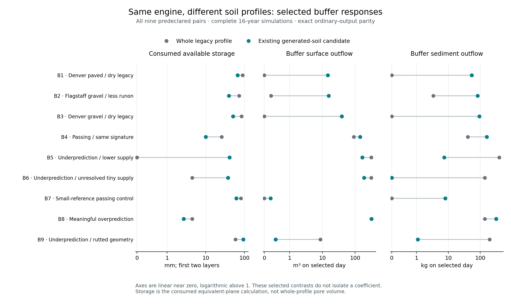

# Revision-4 buffer process findings

Hydraulic state and the resulting water delivery and sediment retention are the
next mechanisms to isolate. The observation study passed all 18 full-period
runs without changing an ordinary output byte. It establishes where the selected
soil-profile responses diverge, but does not select a new parameterization or
identify one coefficient as the cause.

The comparison is between whole legacy profiles and the existing U12
`erosion_road_cap` generated-soil candidate on the same revision-4 engine. That
candidate already uses matched reference road Ki/Kr/critical shear, disables the
road conductivity adjustment and caps upper-200 mm road conductivity. It is not
unmodified SSURGO or every production Roads configuration. No parameters,
production source, binary, defaults, acceptance thresholds or UI changed.

## Evidence and limits

The [predeclared nine-pair panel](../buffer-process-observation-r4-plan.md)
contains diagnostic extremes and passing/opposite-direction controls. Eight
pairs are outsloped/unrutted; the ninth is rutted. Detailed observations cover the
selected day and preceding day, with complete 16-year ordinary outputs.

- All 126 ordinary output files match their original reference bytes. The
  unchanged physical audits pass for all 18 lanes; all 1,677 PASS EVENT rows
  pass the versioned strict particle audit.
- Independent readback covers 133,468 trace rows and 108 day/OFE groups. There
  are 76 observed GRNA calls and 83 sediment-routing groups. Dry outlets do not
  imply skipped sediment routing.
- [Boundary reconciliation](reconciliation.json) checks all 90 present ELEMENT
  observations against native sediment mass using the unchanged ±0.0005 kg/m
  printing interval, and all 108 WAT cumulative-runoff observations using their
  actual emitted printing intervals. Eighteen absent ELEMENT rows stay absent.
- [Hourly return reconciliation](hourly-return-reconciliation.json) reproduces
  all 2,592 observed REAL accumulation steps and all 21 observed ROCHEK-to-IRS
  runoff additions exactly. Return depths use local OFE area; incoming hourly
  return/lateral depths use upstream OFE area. Native REAL geometry and emitted
  ledger geometry remain distinct. These checks do not claim a complete layer
  water budget or final routed hydrograph.

The first build lacked a required calendar-module sibling and stopped before
compilation. The next attempt completed one legacy lane but rejected the pair
when a lazy PyArrow import expanded its dependency inventory. Both attempts
remain retained. The final attempt eagerly binds that existing reader, reuses
the same observer binary and passes all cold/warm dependency and runtime checks.
See the [archive receipt](../revision4-buffer-process-observation-retention.json)
and [reproduction instructions](reproduction.md).

## Paired target-day responses

L→M means whole legacy profile → existing generated-soil candidate. Available
storage is the consumed first-two-layer calculation, weighted over actual
connected contributors; it is not whole-profile pore volume. Minimum K is the
conductivity used by that calculation, not printed effective surface K.
All values below retain their raw operands in the [machine-readable table](paired-target-table.json).

| Pair | Available storage mm L→M | Weighted minimum K mm/h L→M | Buffer surface water out m³ L→M | Hourly surface return m³ L→M | Buffer sediment out kg L→M |
| --- | ---: | ---: | ---: | ---: | ---: |
| B1 · Denver paved / dry legacy | 89.806 → 66.067 | 10.254 → 8.636 | 0.000 → 14.653 | 0.000 → 14.653 | 0.000 → 54.183 |
| B2 · Flagstaff gravel / less runon | 72.720 → 39.658 | 8.357 → 41.616 | 0.265 → 15.620 | 0.000 → 15.588 | 3.362 → 83.322 |
| B3 · Denver gravel / dry legacy | 83.456 → 50.779 | 8.357 → 41.616 | 0.000 → 39.034 | 0.000 → 39.034 | 0.000 → 94.530 |
| B4 · Passing / same signature | 25.594 → 9.966 | 11.404 → 9.720 | 91.630 → 143.025 | 91.630 → 74.885 | 40.691 → 162.033 |
| B5 · Underprediction / lower supply | 0.000 → 40.963 | 8.357 → 27.611 | 312.195 → 167.564 | 186.709 → 167.564 | 396.956 → 7.371 |
| B6 · Underprediction / unresolved tiny supply | 4.463 → 37.392 | 7.494 → 26.709 | 314.618 → 189.191 | 184.373 → 189.191 | 139.575 → 0.000 |
| B7 · Small-reference passing control | 81.175 → 61.515 | 10.254 → 8.636 | 0.000 → 0.249 | 0.000 → 0.000 | 0.000 → 8.061 |
| B8 · Meaningful overprediction | 4.463 → 2.681 | 7.494 → 8.636 | 314.618 → 320.486 | 184.373 → 173.220 | 139.575 → 317.686 |
| B9 · Underprediction / rutted geometry | 58.338 → 92.938 | 7.965 → 17.339 | 8.754 → 0.450 | 3.173 → 0.450 | 196.927 → 1.101 |

In **B1 and B3**, neither lane produces GRNA rainfall excess, and ROCHEK leaves
zero surface runoff. The modern hourly water-balance calculation then produces
14.653 and 39.034 m³ of surface return, respectively; the observed native
addition accounts for all outlet surface water. Legacy produces no return or
outlet water. Legacy nevertheless enters sediment routing and deposits incoming
bulk mass. Modern outgoing bulk mass equals incoming bulk mass, with zero
resolved grid net exchange. This does not establish tagged particle provenance
or exclude simultaneous gross erosion and deposition within a grid interval.

**B2** strengthens the hydraulic question: modern has less incoming surface
water, but much more outgoing water. Its consumed available storage is lower,
while its weighted minimum conductivity is higher. Hourly surface return accounts
for most of its outlet water. A general reduction of buffer conductivity is not
identified by this contrast.

The same processes occur in passing controls. **B4** has about +134.083 kg of
modern buffer grid net exchange versus zero legacy net exchange. **B7** has
about +3.955 kg versus −1.112 kg. Local source interpretation requires actual
interior segment shear/routing state; endpoint shear alone does not determine
what happened inside the buffer.

The opposite controls prevent a universal correction. **B5, B6 and B9** have
100 mm roughness and 11.45 mm depression storage in both lanes, yet differ in
consumed storage, conductivity, flow support and sediment exchange. B5 combines
lower incoming sediment with loss of the legacy positive buffer net exchange.
B6 has no incoming sediment resolved by the printed ledger, while legacy has
about +139.568 kg of buffer net exchange and modern has zero. Its raw incoming
masses are small positive values, not exactly equal: about 0.000146 kg legacy
and 0.000088 kg modern. B9 also changes the effective contributor geometry and
retention. **B8** retains substantial positive net exchange in both lanes
(about 139.568 and 306.744 kg), so the study does not reduce every discrepancy to
whether surface water exists.

## Surface conditioning and the next controlled study

In B1–B4, B7 and B8, modern buffer roughness is 6 mm and computed depression
storage is zero; legacy values are 100 mm and 11.45 mm. The
[separate published-state history](../buffer-published-soil-context-r4.json)
shows persistent legacy roughness and prior modern decay. The native source
places roughness decay inside the bulk-density consolidation branch. Current
observed branch/state differences support investigating that coupling, but do
not prove its initialization history or scientific correctness. B8 is already
consolidated on the observed day despite retaining the earlier roughness decay.

Recommend a separately declared **full-period roughness-conditioning
counterfactual**, using these same pairs, passing controls and opposite-direction
controls. Hold other input parameters and bulk-density handling fixed; change
only the declared roughness-conditioning path and let its derived consequences
respond naturally. Roughness also affects soil shear/erosion corrections, so
this is not a depression-storage-only intervention. Review the exact insertion
point, state provenance and surface-roughness treatment before running it;
retain complete water/sediment and strict particle gates. Do not manipulate
bulk density to force a roughness outcome or search new coefficients.

The counterfactual would test the contribution of a model/input conditioning
path. It would not establish that either legacy or modern roughness is physically
correct. Selecting production values still needs a defensible road/fill/buffer
surface description. Whole-profile and management-state confounding remain;
upstream saved-state operands are observed at consumption, but their assignment
epoch is not always independently known. In these target events, hourly returns
are incorporated before IRS exits; observed runoff does not change afterward.

No new model defect is demonstrated here. The exact revision-4 legacy anchors
still have 17 original annual-benchmark failures, and WEPP2010 event semantics
have not been established. The frozen magnitude criteria, withheld-material
boundary and human gate for UI specification/layout remain unchanged. No
counterfactual or parameter ablation was executed in this observation study.
