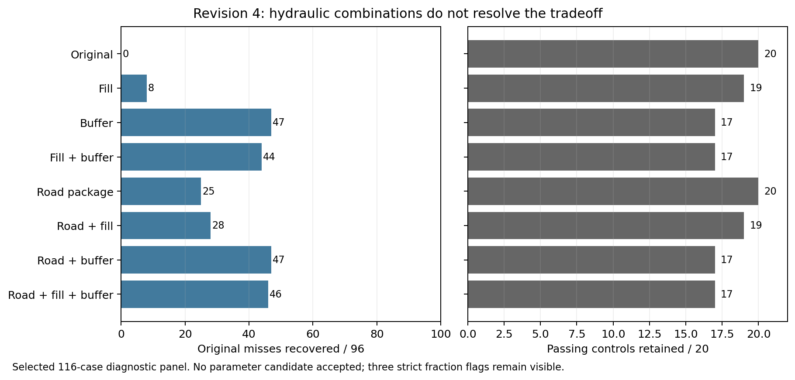

# Revision-4 hydraulic factorial: no parameter candidate accepted

All 928 cells completed and passed the existing bulk/water audit; fresh final
verification rehashed logs and outputs and reran the actual runtime/accounting
checks for every cell. The selected panel contains 96 original magnitude misses
and 20 passing controls. No withheld materials or production defaults changed.

| Treatment | Original misses recovered / 96 | Controls retained / 20 |
| --- | ---: | ---: |
| Original | 0 | 20 |
| Fill fixed | 8 | 19 |
| Buffer cap | 47 | 17 |
| Fill + buffer | 44 | 17 |
| Coupled road | 25 | 20 |
| Road + fill | 28 | 19 |
| Road + buffer | 47 | 17 |
| Road + fill + buffer | 46 | 17 |

The road-only package retains all controls but does not resolve the small-load
group. Every downstream combination loses passing controls. All 43 original
small-reference exceedances are outsloped/unrutted, and 35 fail every tested cell.
Buffer capping increases export in all 43 while recovering meaningful-reference
underpredictions. Thus another uniform reduction or additive combination of
these factors is not supported by this experiment.

Independent review recomputed all 2,204 conditional contrasts (37,468 scalar
values) exactly. Net road/fill/buffer exchange is not tagged particle provenance.
The coupled road factor does not separate pore-volume from conductivity effects.
Some older legacy-soil controls retained more incoming sediment yet exported
less; those revision-3 comparisons motivate an exact-revision-4 anchor replay,
not a causal conclusion about a single soil parameter.

## Explicit particle disposition

Three strict fraction-sum flags remain visible. Two belong to byte-identical
reused U12 cases with accepted arithmetic certificates. The new flag is
site/1718465/outrut/gravel/high, road-plus-fill, 2008 day 278. Its printed fraction
sum exceeds the printing-only bound by about 2.75e-8; class-versus-bulk event mass
still closes within its printed bound. A fresh exact-output-parity observer and [source-derived certificate](fraction-arithmetic-r4-new-event-disposition.md)
explain the flag: native normalization excess 4.7432e-8 lies within the
operation-derived 2.9802e-7 bound, and individual printed fractions satisfy their
original rounding bounds. The implied excess mass is 4.1193e-10 kg.
The strict predicate stays failed and the treatment remains rejected.
No threshold was relaxed, fraction renormalized or failed predicate counted as a
scientific pass. The new configuration is outside the earlier accepted native
benchmark scope; no universal fraction-normalization claim is made.

## Evidence and continuation

- [Frozen declaration](combined-hydraulics-r4-declaration.json), [summary](combined-hydraulics-r4-summary.json) and [all-case verification](combined-hydraulics-r4-verification.json).
- [Independent scientific review](combined-hydraulics-r4-scientific-results-review.md) and [contrast verifier](review_combined_hydraulics_r4_science.py).
- [Initial staging failure](combined-hydraulics-r4-attempt1-failure.json): nine native executions, zero accepted results. The separate v2 rerun explicitly retained audit auxiliaries and passed reused/fresh preflight before broad execution.
- [Next event supply/retention plan](event-supply-retention-r4-plan.md): rebaseline all 116 existing legacy-soil controls on the exact engine, then compare paired event boundaries before selecting further physical hypotheses.

The full 840-case baseline remains 713/766 meaningful and 31/74 small-reference
passes. A selected diagnostic screen cannot replace broad confirmation or the
human approval gate for the configuration specification/layout.
