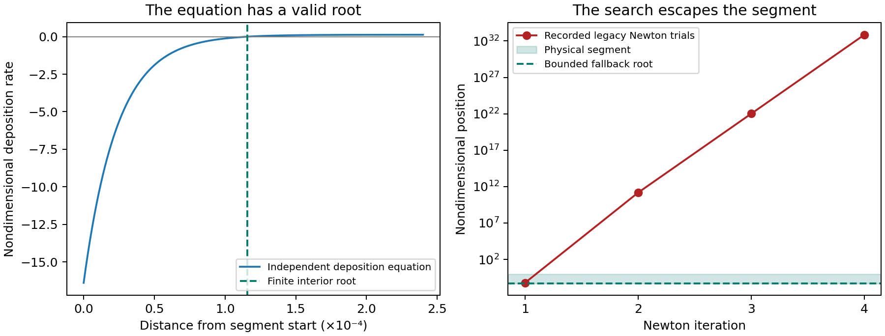

# Draft: deposition endpoint search repair

Status: experimental candidate; not included in the shipped binary.

A Roads study exposed a simulation failure while WEPP was finding where
sediment deposition ends along a slope. The equation had a valid answer within
the slope segment, but its numerical search jumped outside the segment and
eventually overflowed. This was a search failure, not evidence that the soil
inputs or the deposition equation were invalid.

The candidate keeps ordinary convergent searches. When a positive-flow search
leaves the segment, loses its usable derivative or exhausts its iterations,
it locates the transition within a bounded interval. It also checks a related
decreasing-flow quotient before overflow. The deposition equation and soil
parameters are unchanged. This shared routing calculation serves both Roads
and other hillslopes and watersheds.

The retained failing 16-year simulation now completes and passes water and
sediment artifact checks. Independent equation tests cover steep roots,
neighboring float32 inputs, general shear/interrill coefficients and existing
terminal/no-root conventions. Broad scientific gates are still being assessed.
Previously unconverged searches can change sediment outputs; a successful
simulation alone is insufficient evidence for release acceptance.

No Roads parameterization is accepted by this numerical repair. Magnitude
criteria relative to FSWEPP2, withheld-material validation and the human approval
gate for the proposed configuration view remain in force. Shipped revision 3
remains unchanged during this experiment.
