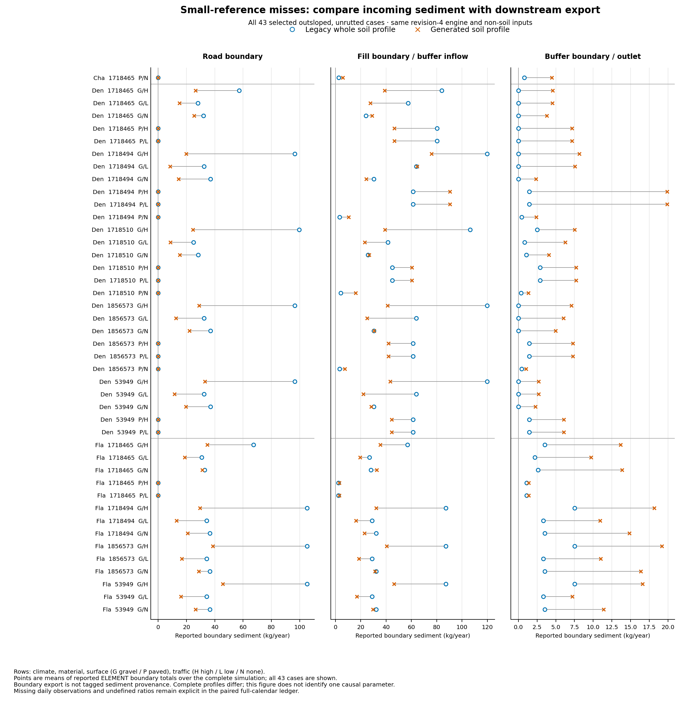

# Revision-4 paired soil-profile ledger

The completed 116-case comparison points first to buffer water delivery and
sediment retention, while preserving an opposite upstream-supply problem in the
underprediction group. It does not identify a replacement parameterization.
Both lanes use the exact revision-4 engine and identical non-soil inputs;
the treatment is the entire legacy or generated soil profile.

Here “generated” is the frozen U12 `erosion_road_cap` research candidate:
configuration-matched FSWEPP road Ki/Kr/critical shear from
[screen.py](../screen.py), disabled road conductivity adjustment and upper
200 mm road conductivity capped at the matched reference effective conductivity
by [engineered_surface_screen.py](../engineered_surface_screen.py). Fill and
buffer materials retain generated profiles. This existing candidate conditioning
introduces no new treatment here; results do not describe unmodified SSURGO
profiles or every production Roads configuration.

## Accounting and coverage

The ledger covers all 96 original diagnostic misses and 20 passing controls,
five climates and seven development materials: 677,904 paired case-days and
2,033,712 paired OFE-days. No withheld material or new native run was used to
build the ledger. The 116 cases reuse 21 complete legacy soil decks; cases are
not independent material replicates.

All 232 historical annual sediment/water audits replay exactly, and all 116
annual reported-sediment difference decompositions reconcile. Independent
readback checks 4,067,424 lane/OFE-day rows, 8,352 annual flux comparisons and
11,832 summary projection values. See the
[independent review](../event-supply-ledger-r4-independent-review.md) and
[final artifact verification](final-verification.json).

Surface runoff volume uses the cumulative contributing OFE area; local water
depths use local area. Sediment boundary mass uses emitted hillslope width.
Historical sediment audits retain their original metadata-width basis, joined
to the emitted basis by an explicit serialization-bound bridge. No model or
audit tolerance changed. Missing ELEMENT observations remain NULL; zeros used
to decompose sums of reported contributions are explicitly bookkeeping values.

There are no missing ELEMENT rows with positive surface flow or observed
positive-sediment/zero-water days in this panel. The 2,131 unavailable `Sm`
diagnostics remain NULL; required accounting fields are available. The 10,718
PASS EVENT rows retain one strict fraction flag in the generated
site/2711250/outunrut/paved/low case on 2003 day 29. Its previously retained
source-derived arithmetic certificate explains the flag; the strict audit
still reports it. Legacy cases have zero flags with the corrected fixed-width
audit. These qualifications do not imply universal numerical or particle closure.

## Paired results

Groups retain their original FSWEPP2/WEPP2010 annual benchmark classifications.
The medians below are annual LOSS exports; paired boundary conclusions use the
separately reconciled ELEMENT ledger.

| Original group | Cases | Generated median kg/year | R4 legacy median kg/year | Lower generated fill supply but higher outlet |
| --- | ---: | ---: | ---: | ---: |
| Small-reference exceedance | 43 | 7.155 | 1.078 | 28 |
| Meaningful underprediction | 48 | 0.808 | 34.500 | 0 |
| Meaningful overprediction | 5 | 198.413 | 58.752 | 3 |
| Meaningful passing control | 18 | 155.711 | 90.874 | 13 |
| Small-reference passing control | 2 | 0.884 | 0.345 | 0 |

All 43 small-reference cases are outsloped and unrutted. Generated profiles
export more at the outlet in all 43, despite lower annual fill-boundary supply
in 28. Median paired annual boundary changes are −12.94 kg at the road,
−10.43 kg at the fill and +5.43 kg at the outlet. All 43 are visible below;
different panel scales preserve the large upstream supply and small outlet.

The opposite discrepancy remains substantial: all 48 meaningful underpredictions
have lower generated outlet export and 44 have lower fill supply. Their median
paired annual changes are −25.39 kg at the road, −84.03 kg at the fill and
−33.77 kg at the outlet. A universal retention adjustment could worsen these
cases and passing controls. The lower-fill/higher-outlet pattern already occurs
in 13 of 18 meaningful passing controls.

The same-engine legacy lane is a diagnostic anchor, not the acceptance target:
99 of 116 legacy anchors satisfy the frozen WEPP2010 benchmark criteria; 17
still fail: 15 are from the original small-reference group and one each from
the original meaningful-underprediction and meaningful-overprediction groups.
Those group names classify the original generated-soil benchmark result, not
the direction of the legacy anchor's error. No WEPP2010 event contract was assumed.

## Exploratory hydraulic association

The frozen summary identifies 118 small-group case-days with lower generated
incoming sediment and higher outgoing sediment. On 115 days, both differences
exceed the combined unchanged native printing intervals. They occur in 37 cases
but only 19 distinct climate/date combinations, so they are not 115 independent
storms. Their 2,613.13 kg excess contributes to the 4,343.33 kg net outlet
difference over the full case periods; repeated materials/weather prevent a
population interpretation.

The separately labeled [post hoc cross-tab](exploratory-hydrology.json) shows:

- Generated buffer surface outflow and printed peak runoff are higher on all
  115 days; legacy surface outflow is zero on 101.
- Generated surface inflow is higher on 73 days and lower on 42. Greater incoming
  water alone therefore does not explain every selected discrepancy.
- Effective duration is higher on 70 days and lower on 45. Generated lateral
  inflow is higher on 46 and lateral outflow on 56; legacy lateral flux is zero
  on all 115. Rain/melt volume is identical in each pair.
- Printed buffer effective conductivity is higher in all 115. This does not
  isolate infiltration: profile depth, water retention, restrictions, antecedent
  state, inflow rate and routing differ with the complete profiles.

The outlet-volume ratio has a median of 31.08 only among the 14 positive legacy
denominators; the other 101 ratios are undefined. The peak-rate ratio median is
149.38 over those same 14 positive denominators. Undefined values were not
replaced with epsilons. The strongest next question is how buffer runoff support,
storage and rates differ, and how those differences interact with incoming
particle loads and local erosion/deposition. Terminal fractions alone cannot
answer it.

## Interpretation limits and retained findings

Boundary outflow minus inflow is net OFE exchange, not tagged source material
or separate gross erosion and deposition. PASS composition is an **EVENT-only
sediment-mass-weighted terminal clay fraction**; SUBEVENT/no-event class data are
excluded. It is not the composition of all annual export, the incoming mixture
or an upstream/OFE-specific source attribution.

Only 37 of 38 paved cases have zero reported road export in both lanes. The
Denver/2711184/outrut/paved/none exception has legacy 0.001485 and generated
0.0002475 kg/year and cannot serve as a literal zero-road-source control.

The frozen analysis declaration called its ranking “largest positive,” but the
executed SQL retained the **three largest reported daily outlet differences
per case**, including zeros, from the full daily ledger. The retained
`top-discrepancy-events.json` has 196 positive and 152 zero rows, no negatives;
its filename does not establish PASS EVENT classification. Executed source and
declaration remain unchanged. A separate positive-only list and an exploratory
negative-tail list make subsequent selection explicit.

The [ELEMENT erodibility metadata finding](element-erodibility-metadata-finding.json)
is a separate confirmed reader-contract defect: native printed Ki is SI Ki
divided by 10⁶ and printed Kr is SI Kr multiplied by 10³, while Python and Rust
schemas label both as bare SI. This ledger retains raw numbers and explicit SI
conversions. The minimal follow-up corrects both metadata definitions while
preserving existing numeric columns; no consumer calculation error or native
parameter defect is established here. Frozen schemas and Parquets were not edited.

The first ledger preflight failed on JSON serialization of a typed count; the
second attempt stopped at an unjustified exact width-equality assertion.
Both failed roots and logs are retained. Version 3 predeclares all-case emitted
geometry checks, an explicit token-precision bridge and two distinct geometry
preflights. No inference uses incomplete attempts.

## Continuation

Declare paired source observations on deterministic cases from this verified
panel, including actual zero-road paved cases, gravel hydraulic contrasts,
passing controls and meaningful-underprediction supply controls. Observe actual
buffer inflow and outlet hydraulics, infiltration/storage/routing branches,
incoming and outgoing class loads, effective erodibility/critical shear,
transport capacity and available local source/deposition accounting. Require
full-period ordinary-output byte parity before interpreting added traces.
Class-load differences are not tagged provenance.

This study accepts observational accounting only. It changes no defaults,
coefficients, acceptance thresholds or user interface. The UI specification
and layout remain human gated. Reproduction instructions and frozen scripts
are in [reproduction.md](reproduction.md).
