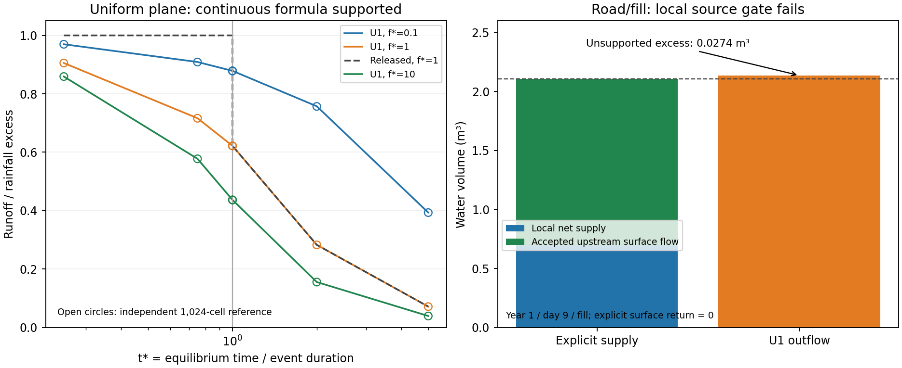

# D1 physical domain and local surface-source audit

**The continuous scalar QINF formula is supported within its idealized domain;
U1 alone is rejected for promotion as the complete multi-OFE repair.** A known
unsupported local surface-water source remains. The broad adoption gates were
therefore not run on this candidate. Retain the scalar correction as a useful
component for the next ownership candidate; do not discard the evidence or ship
it as a complete repair.

## Formula-domain evidence

Stone, Shirley and Lane (1993) derive a general recession solution for one plane
with constant rainfall excess during the event and constant infiltration during
recession. The branch boundary is ftest, not tstar=1. Variable-rainfall use is an
approximation. [Original paper](https://www.tucson.ars.ag.gov/unit/Publications/PDFfiles/944.pdf).

WEPP's 1995 Chapter 4 presents these equations and plots their lower branch below
one in Figure 4.4.5. Its multi-OFE averaging is a separate approximation, with
limitations discussed in section 4.6. [USDA documentation](https://www.ars.usda.gov/ARSUserFiles/50201000/WEPP/chap4.pdf).

These sources support continuity of the scalar formula; they do not establish
that differences of independently calculated cumulative losses are valid local
infiltration transfers on heterogeneous elements. This distinction is our
inference, tested separately below. No change to the production formulas was
made in D1.

## Independent numerical check

A new conservative Fortran reference solves the surface continuity equation
using an upwind finite-volume flux. It does not call QINF or reuse its equations
for routing. Scale length, hydraulic coefficient and rainfall-excess rate to
one; use m=1.5. Supply constant excess until duration 1/tstar, then remove water
at fstar only where surface water exists. Upstream boundary flux is zero. Track
input, outlet flow, infiltration and remaining surface storage independently.

Predeclared panel: fstar 0.1/1/10; tstar 0.25/0.75/0.9999/1/1.0001/2/5;
64/256/1024 cells, CFL 0.4. These are 63 reference solves over 21 parameter
combinations. Native released/U1 scalar calls cover the same 21 combinations
(42 native subroutine calls, not 42 full WEPP runs).

| Cells | Maximum absolute runoff-fraction difference from native U1 |
| ---: | ---: |
| 64 | 0.008136745 |
| 256 | 0.002072002 |
| 1024 | 0.000522726 |

The finest grid passes the predeclared 0.005 absolute-fraction comparison.
Maximum volume residual is 9.594e-13 against the predeclared 1e-10 check; minimum
surface storage is zero. Limits were not changed after seeing results. This
shows refinement convergence for this panel, not universal error bounds or
validation of variable rainfall, finite soil capacity, heterogeneous chains,
return flow, lateral flow or sediment routing.

## Remaining exchange: source failure, not lack of funding

The retained committed delayed-return fixture, simulation year 1/day 9/element 2,
has these U1 volumes:

| Quantity | m³ |
| --- | ---: |
| Local net supply | 0.698124621 |
| Accepted upstream Hortonian inflow | 1.410935473 |
| Outgoing Hortonian runoff | 2.136466063 |
| Excess over those surface sources | **0.027405968** |
| Upstream surface return | 0 |
| Local surface return | 0 |
| Upstream lateral input to soil | 0.033358098 |
| Starting available soil water | 0.909017683 |

The excess is 1.514376 mm on the local element. The native FIN calculation debits
approximately that amount from soil. The released counterpart already had a
larger negative FIN, −22.576984 mm; U1 reduces it to −1.514375 mm but does not
remove its unsupported source attribution.

QINF's Hortonian result is generated before the hourly soil balance from surface
rainfall-excess/routing operands. It has no antecedent-liquid-water or exfiltration
input. The separate incoming lateral quantity enters soil, and both observed
surface-return terms are zero. Re-labeling lateral input or available soil stock
as QINF surface supply would introduce an unimplemented transfer and could
count water twice. D1 therefore classifies this particular exchange as a
local ownership defect. It does not prohibit all negative FIN values: explicit,
accounted physical sources must still be distinguished from unsupported ones.

Whole-profile conservation and successful hourly funding cannot establish this
local process identity. There is no numerical-tolerance ambiguity: the excess
is 0.0274 m³, while retained operand reconstruction error is about 1.6e-8 m³ for
this event. No residual was clipped or moved to a different sink.

## Decision and continuation

U1 clears the scalar-domain experiment and fails the local surface-source gate.
Its twelve completed runs remain true, but they are not physical acceptance.
Do not promote U1, inspect withheld outcomes, or fit Roads parameters around it.
The [D2 continuation](native-D2-local-ownership-plan.md) scopes a conservative local
surface-transfer reference and the requirements for a subsequent U2 native
producer correction. Preserve existing hydraulic length and incoming-event
contracts; do not restore C3 or mask the discrepancy with outlet clipping.

No additional full WEPP matrix was executed in D1. Native production source,
released binaries, Roads parameters and UI are unchanged. Broad native,
Disturbed, Cedar Creek and Roads adoption gates await a candidate that passes
local ownership. The human UI specification/layout gate is unchanged.

## Reproduction and retention

Helpers: domain_reference.f90, domain_probe.py and audit_local_source.py.
Receipts: D1-domain-summary.json, D1-local-source-audit.json and D1-sources.json.
The source-audit fixture is committed tests/fixtures/hourly_return_timing/inputs.zip,
SHA-256 64eb68c9a408b36abd5658aea68a039014620f7340236b0aa518b9e4a72677fc.
The selected raw trace and its complete parent trace are hash-addressed; no new
private model inputs are required. Original articles, local PDF figure rendering,
reference outputs/executables and native scalar probe outputs are retained in
the separate domain-review-v1 archive. See D1-retention-receipt.json.

Native helpers and receipts above live in
`/workdir/wepp-forest-release-20261009/docs/work-packages/20261031-roads-open-boundary-funding/artifacts`.

Validation: the predeclared D1 numerical checks pass, while the local source
gate fails as documented. Native artifact policy, incident finalization, scoped
Markdown lint and changed-scope diff checks pass. No full release test suite
was rerun because standalone U1 is rejected before the broad-gate stage.

Retention verified: 115 files; archive SHA-256
`fdee31fbe8c1babb57468978bc9ab6c34c697b9265f5c6c4e5e48493a2427cc2`.
