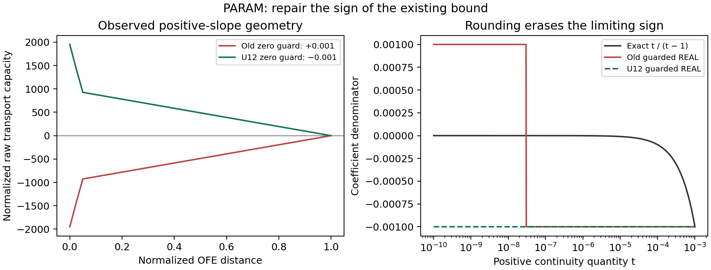

# Draft: preserve the sign of continuity coefficients

Status: historical experimental draft, superseded by the independently approved
[revision-4 release report](../../../../wepppy/weppcloud/static/reports/wepp/release-notes/wepp_261029/wepp_261029_release-notes-r4.pdf).
The exact U12 pair is now installed as revision 4; complete scientific/Cedar
acceptance is retained in [the final receipt](param-u12-scientific-acceptance.json).
Statements below describe the earlier experimental checkpoint, not current gates.

A Roads investigation found that WEPP could generate a negative sediment
transport capacity on a wet slope even when the physical inputs were positive.
The calculation connects conditions between overland-flow elements. A very
small positive value disappeared when stored in single precision. An existing
division guard then chose the wrong sign, reversing the resulting capacity.

The candidate corrects that sign in both transport and the corresponding shear
calculation. It preserves the guard's existing magnitude and all nonzero cases.
This is shared native WEPP code, so its implications extend beyond Roads.
It repairs the sign of an existing numerical approximation; it does not claim
to restore exact continuity in the singular limit.

The left panel uses the observed positive-slope geometry and rounded ratio.
The right panel compares exact arithmetic with the old and proposed guarded
single-precision denominator. These illustrate the calculation, not an erosion
prediction or a Roads calibration result.

Fifteen source-executed PARAM controls and1253 native regression tests pass. Four full16-year development seeds pass
physical checks and all1306 EVENT particle checks. Separate transport-only,
shear-only and combined runs attribute the observed output changes to transport;
water/soil outputs are unchanged. Exact-parity observation removes the material
negative capacities. Very small terminal roundoff slivers remain explicitly
bounded and tracked. All840 Roads,348 downstream,99 Disturbed and28 watchlist cases pass their
physical/execution checks. Full1188 exact-parity capacity observations have
bounded dry-terminal support; two strict fraction-sum flags have source-derived
numerical explanations and remain reported unchanged. Cedar semantic analysis
is still in progress. The magnitude score remains713/766 meaningful plus31/74
small-reference cases; no parameterization acceptance follows.

See [proposed ADR-0124](../../../adrs/ADR-0124-param-rounded-continuity-denominator-sign.md)
and [the active ablation](erod-subgrid-ablation-plan.md). No production binary,
Roads default or user-interface configuration has been promoted by this work.
