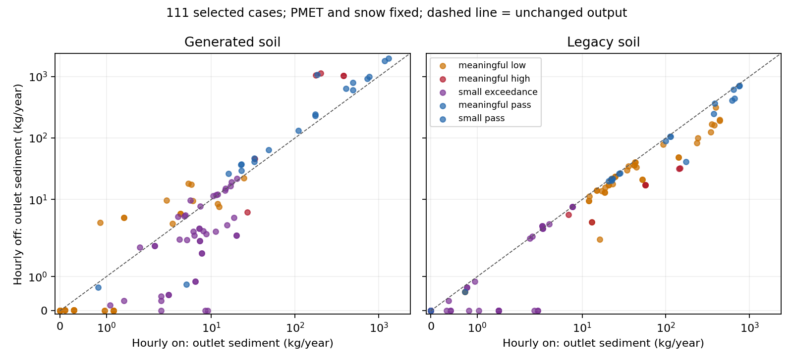

# Generated soil by hourly-mode interaction

Completed 2026-10-31 UTC under `prompts/active/program_execplan.md`. Fixed
`wepp_261029` revision 2 SHA-256:
`819b91721f67c4a86a5ecea14c5beb840e9a705025da2a2cedf2b97a5e067715`.
No production defaults, soil properties, native binary or acceptance rules changed.
Withheld materials remain unopened; UI specification/layout approval remains required.

## Design and verification

Complete generated/legacy soil × hourly on/off for the same 111 diagnostic cases:
444 cells. PMET and snow sidecars remain present. Removing only `wepp_ui.txt`
switches the native water-balance routine; all other inputs are byte-identical
within each soil pair. Soil pairs differ only in `p1.sol` within each runtime.
Generated profiles retain their 200 mm boundaries, horizons and restrictions.

The preceding recommendation underestimated the missing cells: legacy hourly-off
existed for only 14 cases. The frozen declaration therefore specifies **208 new
runs** (111 generated, 97 legacy) and **236 reused cells**, rather than 111 runs.
All 208 new runs completed and passed the unchanged physical checks. Independent
readback rehashed inputs/outputs and recomputed native sediment, water, calendar
and event audits for **all 444 cells**, reproducing the stored audits exactly.
All 444 passed. Apparent WAT residuals are not a complete water-closure measure.

This subset deliberately contains all 91 original misses and 20 passing controls.
It is not a representative acceptance panel; duplicate legacy input sets remain
labeled aliases, not independent materials. Raw counts cannot replace the frozen
840-case acceptance results.

## Magnitude results

Counts within the unchanged criteria; groups are fixed by the original generated,
hourly-on case, not reclassified after the intervention.

| Original group | Cases | Generated on | Generated off | Legacy on | Legacy off |
| --- | ---: | ---: | ---: | ---: | ---: |
| Meaningful high misses | 6 | 0 | 1 | 5 | 6 |
| Meaningful low misses | 41 | 0 | 6 | 40 | 41 |
| Small-load exceedances | 44 | 0 | 14 | 31 | 41 |
| Meaningful passing controls | 19 | 19 | 18 | 19 | 19 |
| Small-load passing control | 1 | 1 | 1 | 1 | 1 |
| Total selected cases | 111 | 20 | 40 | 96 | 108 |

Generated hourly-off recovers 21/91 misses and loses one passing control. That
regression is site/sand 1718465, outunrut, gravel/high: export increases from
185.27 to 1072.93 kg/year against a 20.22 kg/year reference. Legacy soil for the
same case decreases from 173.54 to 41.47 kg/year. A runtime switch therefore does
not transfer uniformly across soils and is not an acceptable general remedy.

The three remaining legacy-off misses are aliases of one consumed input set:
Flagstaff/loam, outunrut, gravel/high, labeled 1718494, 1856573 and 53949. Export
is 7.58652 kg/year versus reference 0.56037 kg/year and bound 5.60368 kg/year.

The dashed line denotes unchanged sediment, not an acceptance boundary. Axes use
a linear region near zero and logarithmic scaling above it; overlapping aliases
are not independent evidence. Point colors describe the original generated case.

## Water partition and native boundary context

Median paired changes below are **hourly off minus on**, in m³/year. These are
medians of 111 paired changes, not differences between group medians. OFE lateral
outflows are internal boundary fluxes and must not be summed as watershed export.

| Soil | Role | Surface outflow change | Lateral outflow change | Deep percolation change |
| --- | --- | ---: | ---: | ---: |
| Generated | Road | +5.51 | -36.78 | +6.70 |
| Generated | Fill | +3.67 | -21.20 | +0.67 |
| Generated | Buffer | -0.06 | -42.31 | +1.53 |
| Legacy | Road | -0.45 | 0.00 | +1.16 |
| Legacy | Fill | -2.24 | +0.25 | +0.53 |
| Legacy | Buffer | -0.70 | +0.02 | +0.54 |

The contrast is consistent with substantial soil-dependent changes in lateral
flow and drainage, but it does not isolate conductivity, texture, storage, profile
depth or restriction as a single cause. The signed sediment interaction is defined
as `(generated off - generated on) - (legacy off - legacy on)`; its median absolute
value is 4.18 kg/year. The material-specific case above shows why this aggregate
alone is insufficient.

Source readback at native delivery commit `0df4c9227` confirms `main.for:164`
selects `ui_run` by file presence and `watbal.for:252` dispatches the hourly routine.
`input.for:668` reads the lower-boundary triplet, converting conductivity to m/s
and thickness to m. `perc.for:188–217` uses the restrictive conductivity and different
bottom-conductivity combination formulas in daily and hourly branches. All seven
generated materials emit `slflag=1` and `ui_bdrkth=10000 mm`; their profile depths
range from 400 to 2600 mm and boundary conductivities from 0.00013 to 0.01 mm/hour.
The 10 m value is the supplied lower-layer thickness term in the hourly formula,
not the generated profile depth. Source excerpts/hashes and role-wise input values
are retained in `soil-hourly-boundary-context-v1.json`.

## Disposition and continuation

Reject hourly-off as a standalone generated-soil candidate. Keep production and
research baseline runtime unchanged. The full development gate remains 719/766
meaningful and 30/74 small-load passes, with 840/840 physical passes. The six
hourly/Penman guard failures from the preceding study remain separate unresolved
alternate-runtime failures; this PMET-on study does not repair them.

Next, trace the seven development materials' lower-boundary provenance through
WEPPcloud generation and native initialization, distinguishing observed mineral or
geological restrictions from missing-information defaults. Reconcile emitted
profile depth, lower-layer thickness, conductivity, storage and lateral-flow
semantics. This source/provenance audit should define the next bounded hydraulic
contrast; it must not infer a wrong restriction merely because sediment differs.
Any subsequent sensitivity must retain generated material, 200 mm normalization
and source-supported restriction classes. Do not tune bedrock conductivity to
match sediment or repeat the rejected erosion-only/runtime mechanisms. Review
existing hydraulic-flag experiments before declaring a new contrast.

Full development, independent withheld, geometry, climate-runtime and disposable
production-builder validation remain required before parameter adoption or UI design.

## Artifacts and reproduction

- Declaration/execution: `soil_hourly_interaction.py --declare`, then without the
  flag, through `wctl exec -T weppcloud /opt/venv/bin/python`; roots refuse overwrite.
- Independent readback: `analyze_soil_hourly.py`; figure: `plot_soil_hourly.py`.
- Frozen manifest: `soil-hourly-interaction-v1-declaration.json`; execution summary:
  `soil-hourly-interaction-v1-summary.json`; full paired data and audit provenance:
  `soil-hourly-interaction-v1-analysis.json`.
- Current candidate ledger: `candidate-ledger-v3.json`; v2 remains historical.
- New raw executions and readback evidence:
  `/wc1/runs/ro/roads-parameterization-program-20261031/soil-hourly-interaction-v1.tar.gz`,
  verified manifest/receipt sidecars and `soil-hourly-archive-v1.json`.
  Reused inputs/outputs remain at declared source paths with their prior retention
  receipts; this archive retains the new executions and their four-cell provenance.
