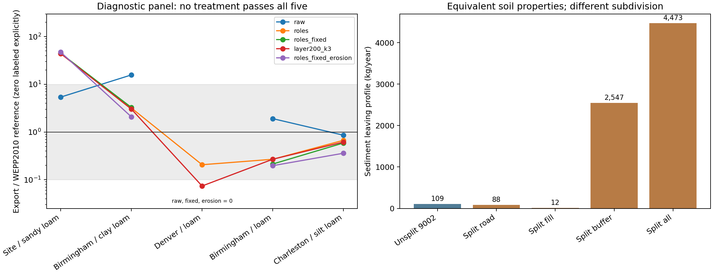

# Roads prepared-soil and hydraulic experiment

Status: scientific execution, artifact revalidation and repository checks complete. Date: 2026-10-29. No production candidate accepted.

## Finding

**Separating road, fill and forest-buffer soils improves some comparisons, but
no tested treatment passes all five diagnostic profiles.** A new finding limits
further tuning: nominally equivalent soil-horizon subdivision substantially
changes the native model's response for the sandy-loam profile.

A redundant boundary at 200 mm changes common-report sediment export from
**109.1 to 4,473.3 kg/year**, with all physical horizon properties preserved.
Changing only the file format to 9002 while retaining the original horizons gives
109.1 kg/year again. Buffer-only subdivision gives 2,547.4 kg/year. The format
label itself is not the cause isolated by these controls.

Exact-release source shows an in-place conductivity assignment during conversion
to 200 mm model layers. Its effect can persist into deeper material when a source
horizon crosses that boundary. See [mechanism evidence](artifacts/mechanism.md).
No internal native arrays were instrumented; source-bound reasoning supplements
the observed split/unsplit native outputs.

## Preparation and experimental scope

Five actual WEPPcloud-generated 7778 base soils were staged: the previous sand,
loam, silt and clay-class specimens plus new loam 2711195 from clogging-starch.
The new specimen was reserved before its modeled outputs were inspected. It
adds within-class variability, not independent geographic or field validation.

Each was processed with the owned `WeppSoilUtil.to_over9000` and `prep_soil`
functions. The primary prepared inputs are **9002**, with the current production
land-soil lookup and initial saturation 0.75. The main controls preserve original
profile depth and lower-boundary conductivity. A separate project-settings
control uses Kslast 0.01 mm/h and clipping at 700 mm, as observed in a retained
project artifact. It uses the current lookup, not the historical customized
project lookup. Both lookup identities and the real project-prepared example
are retained. No claim is made that this function-level replay reruns the entire
project orchestrator or Roads preparation path. 9005 was not evaluated.

The roles treatment assigns **bare soil conditioning to road and fill, forest
conditioning to the buffer**. These are explicit study assumptions, not new
Roads defaults. Soil substitutions retain each paired climate, three-element
geometry, management and 16-year duration. Thus changing soil landuse metadata
does not also change the management file; their full production coupling remains
outside this controlled experiment.

The diagnostic panel includes the prior sandy-loam unrutted failure, Birmingham
clay-loam unrutted failure, Denver loam zero-runoff case, Birmingham loam drainage
case and an agreeing Charleston silt-loam case. It comprises 130 experimental
modern runs plus ten binary controls. The subdivision panel adds 25 experimental
modern runs and ten binary controls. All 175 native cases completed and passed
artifact/calendar/common-report revalidation.

## Diagnostic results

Common detailed-report full-profile export, kg/year. The 200 mm / 3 mm/h column
holds road erosion fixed and disables the road's saturation-dependent Ksat
adjustment. Reference erosion changes road Ki, Kr and critical shear together,
with that adjustment disabled; fill and buffer stay as in roles.

| Climate / specimen class | WEPP2010 reference | Raw generated | Roles | Road 200 mm / 3 mm/h | Road reference erosion |
| --- | ---: | ---: | ---: | ---: | ---: |
| site / sand | 20.22 | 109.10 | 897.41 | 887.88 | 952.37 |
| birmingham / clay | 223.76 | 3521.01 | 711.58 | 675.63 | 464.42 |
| denver / loam | 22.48 | 0.00 | 4.63 | 1.66 | 0.00 |
| birmingham / loam | 521.64 | 994.67 | 139.81 | 140.06 | 102.68 |
| charleston / silt | 51.93 | 44.49 | 34.76 | 31.98 | 18.63 |

Roles passes four of five positive-reference export comparisons. Its sandy-loam
site result remains about **44 times** the reference. Disabling road conductivity
adjustment loses Denver runoff; copying erosion parameters alone does not fix
it. The combined road erosion-and-rock treatment also fails the sandy-loam case.
No combined hydraulic/erosion candidate was advanced: the bounded hydraulic
sweep did not resolve that case, and reference erosion increased its export.
This does not prove that every possible parameter combination would fail.

The hydraulic sweep crosses 50, 200 and 400 mm treatment depths with 1, 3 and
10 mm/h conductivity. These are sensitivity brackets around the production
200 mm boundary and retained reference-road values, not field-calibrated
compaction parameters. A 400 mm treatment covers the entire original sand/clay
specimen depth. The exact native source forces the first 200 mm model layer's
conductivity from the top input horizon, so nominal 50 and 200 mm treatments
can be indistinguishable. Input-layer thickness is not automatically the
hydraulically effective treatment thickness in this binary.

Native modern PASS diagnostics are retained separately: runoff volume, lateral
flow, baseflow, detachment, signed deposition and PASS export. They are not mixed
with detailed-report cross-binary ratios. Spatial net loss from the shared
report is not road-only detachment or gross daily erosion.



## Frozen confirmation and acceptance

No parameter candidate passed diagnostics. Before new-specimen results were
available, [selection](artifacts/selection.json) froze roles and raw as
**confirmation treatments**, not accepted calibration. The broader run covers
five climates × five specimens × four designs × two surfaces × three traffic
states: 600 profiles per treatment. It adds 240 fresh WEPP2010/modern legacy-input
controls for the new specimen; old-specimen reference artifacts are reused only
after rechecking their hashes and matched inputs. Total: 1,440 new native runs.

All 1,440 cases completed and passed artifact/calendar/report revalidation;
600 references were verified. All 480 repeated raw-soil cases exactly match
every metric and annual export series retained from the previous benchmark.

| Treatment | Export within factor ten | Spatial net loss within factor ten | Runoff within factor ten |
| --- | ---: | ---: | ---: |
| Raw generated soil | 361/563 (64.1%) | 469/600 (78.2%) | 342/568 (60.2%) |
| Bare road/fill, forest buffer | 503/563 (89.3%) | 570/600 (95.0%) | 405/568 (71.3%) |
| Raw, new held-out loam only | 84/114 (73.7%) | 93/120 (77.5%) | 48/114 (42.1%) |
| Roles, new held-out loam only | 98/114 (86.0%) | 117/120 (97.5%) | 72/114 (63.2%) |

There are 37 zero-reference-export cases: raw becomes positive in six and stays
zero in 31; roles becomes positive in 13 and stays zero in 24. Both treatments
remain zero for all six zero-reference held-out cases. Denominators are never
replaced by floors. Runoff has its own positive-reference count of 568.

Failures are concentrated in unrutted profiles: roles meets the export band in
only **58/113** positive-reference unrutted cases. The site clay-loam unrutted
paved/high-traffic case exports **1,463 versus 65.5 kg/year (22.3×)**; site sandy
loam unrutted gravel/no traffic exports **955 versus 14.0 kg/year (68.2×)**.
These are substantial absolute differences, not merely near-zero ratios.

For the original four specimens alone, roles meets the export band in 405/449;
the prior all-OFE reference-override treatment met it in 420/449. Roles improves
over raw but is not a new best pooled fit. It explicitly preserves distinct
soil landuse roles and still fails scientific acceptance.

The broad roles treatment does not add pavement-, gravel- or traffic-specific
soil overrides. High/low traffic can therefore coincide where management is
identical. This is a diagnostic soil-conditioning comparison, not a complete
surface/traffic parameterization ready for production. No coefficients were
refitted after examining the held-out soil.

## Disposition

Do not promote the tested soil adjustments or tune erosion coefficients to hide
the subdivision sensitivity. Resolve and regression-test the intended native
0–200 mm conductivity treatment before another calibration exercise. That
requires a separately scoped native-source repair, rebuilt binary and downstream
validation; this experiment deliberately fixes `wepp_261026`.

Even after that issue is resolved, similarity to fswepp2 is not field validation.
The earlier study's extreme long-road results also existed under WEPP2010;
length/segmentation, ditch/pavement assumptions and metric interpretation remain
separate from this prepared-soil study. Removing a boundary merely to reduce sediment would hide the sensitivity.
A native repair need not lower predictions: the unsplit input can drain more
because its deeper conductivity was increased. No production defaults, native
source, binaries or source projects were changed. Actual full-project Roads integration
is conditional on a scientifically accepted candidate and was not entered.

## Evidence and reproduction

A small [reproducer](artifacts/reproducer/reproduce.py) includes the exact split
and unsplit native inputs with hashes, independent of the original source projects.
Its two fresh native replays reproduce both expected exports exactly and pass
calendar/annual-report checks; [replay evidence](artifacts/results/minimal-replay.json)
is retained. These two replay runs are additional to the 1,615 study cases.

```bash
wctl exec weppcloud python docs/work-packages/20261029_roads_prepared_soil_hydraulics/artifacts/reproducer/reproduce.py --destination /wc1/runs/ro/roads-subdivision-replay-UNIQUE
```

- [Preparation manifest](artifacts/results/preparation-manifest.json): actual sources, current lookup, preparation settings, intermediate/readback identities and source hashes.
- [Confirmation comparisons](artifacts/results/confirmation-comparisons.csv), [grouped summaries](artifacts/results/confirmation-summary.json), and [complete case evidence](artifacts/results/confirmation-evidence.json).
- [Raw baseline repeatability](artifacts/results/raw-repeatability.json): all 480 shared cases match prior scientific metrics.
- [Diagnostic comparisons](artifacts/results/diagnostic-comparisons.csv) and [subdivision comparisons](artifacts/results/subdivision-comparisons.csv).
- [Physical-profile equivalence audit](artifacts/results/subdivision-equivalence.json): matching interval properties and unchanged non-layer parameters for all five profiles and three elements.
- Raw inputs, outputs, native PASS parquet, executed source snapshots and exact-release native source: `/wc1/runs/ro/roads-prepared-soil-hydraulics-20261029`.

From `/workdir/wepppy`, substitute a new scratch root throughout:

```bash
wctl exec weppcloud python docs/work-packages/20261029_roads_prepared_soil_hydraulics/artifacts/experiment.py stage --root /wc1/runs/ro/roads-prepared-soil-UNIQUE
wctl exec weppcloud python docs/work-packages/20261029_roads_prepared_soil_hydraulics/artifacts/experiment.py diagnostic --root /wc1/runs/ro/roads-prepared-soil-UNIQUE --batch diagnostic-v1 --workers 12
wctl exec weppcloud python docs/work-packages/20261029_roads_prepared_soil_hydraulics/artifacts/experiment.py diagnostic --root /wc1/runs/ro/roads-prepared-soil-UNIQUE --batch subdivision-v1 --variants split_all split_road split_fill split_buffer format_unsplit --workers 8
wctl exec weppcloud python docs/work-packages/20261029_roads_prepared_soil_hydraulics/artifacts/experiment.py validation --root /wc1/runs/ro/roads-prepared-soil-UNIQUE --batch confirmation-v1 --variants roles raw --workers 16
wctl exec weppcloud python docs/work-packages/20261029_roads_prepared_soil_hydraulics/artifacts/analyze.py --root /wc1/runs/ro/roads-prepared-soil-UNIQUE --batch confirmation-v1 --destination /wc1/runs/ro/roads-prepared-soil-UNIQUE/confirmation-analysis-v1
```

One analysis attempt rejected old execution records because they lack the
new annual-mean-delta diagnostic field. The corrected analyzer requires every
original scientific metric to match fresh strict parsing, while retaining the
additional field. The failed attempt and source snapshots remain in
[analysis attempts](artifacts/results/analysis-attempts.json); no native run failed.

The previous benchmark root and source specimen files are local prerequisites.
Batches refuse existing destinations. All new study artifacts are additive;
source projects and the previous package remain unchanged.

Repository validation: **12,083 passed, 298 skipped, no failures**, across fresh
disjoint groups. See [validation evidence](artifacts/validation.md).
