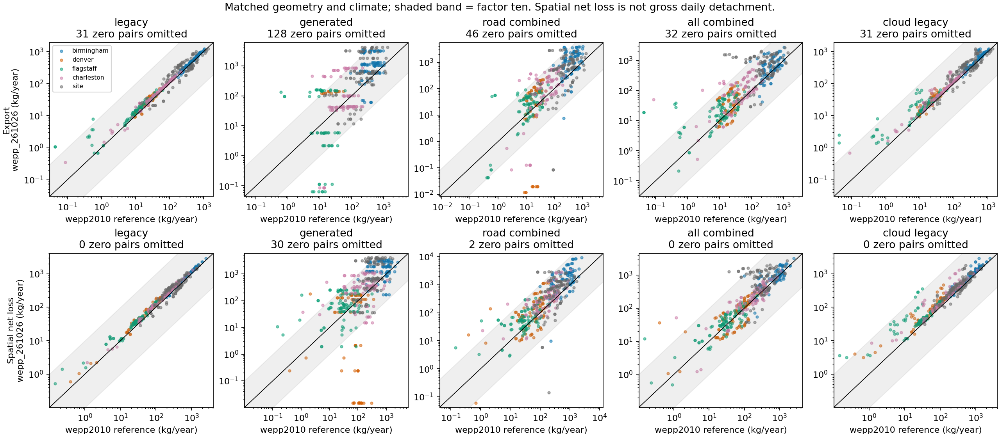

# Roads generated-soil benchmark results

Date: 2026-10-29. Scientific study complete; no production candidate accepted.

## Finding

**The updated binary is already broadly comparable to WEPP2010 when inputs are
matched. Substituting generated soils is the larger change.** The best combined
soil adjustment puts 420 of 449 positive-reference export comparisons within a
factor of ten, but material failures remain. Do not promote a blanket adjustment
or multiply modeled sediment by a correction factor.

The original high-loss stress geometry also remains extreme under WEPP2010:
**842 versus 926 tonnes/ha/year** of spatial net soil loss for the long paved-silt
bare-ditch road under WEPP2010 and WEPP261026 respectively. This is about a 10%
increase, not a new order-of-magnitude effect of the updated binary. Both rates
are model results, not field measurements or validated absolute erosion rates.

## Executed comparison

The main matrix contains **2,880 successful native runs**: five climates × four
generated soil specimens × four designs × two surfaces × three traffic states ×
six execution/soil variants. Every case passed consumed-input/output hash checks,
finite daily WAT checks, complete 16-year calendars, and annual/final-report
consistency. The report verifies that binary-only controls have identical soils,
management, slopes, climate and run prompts. Soil comparisons retain identical
management; the current-selection control changes management explicitly.

An earlier 96-case screen selected the two combined candidates. Charleston and
the clay-loam specimen were withheld from that screen. Ten original-duration
reference replays, fifteen modern native PASS diagnostics and six long-road
stress runs provide supplementary evidence. Failed and superseded attempts remain
in the scratch root; they are not counted as completed matrix cases.

The main matrix uses matched three-OFE road/fill/buffer profiles: road length
60.96 m, width 3.96 m, grade 4%; fill 4.57 m at 50%; buffer 39.62 m at 25%.
Unrutted geometry follows the fswepp2 transformation and emitted precision.
This isolates parameter effects; it does not reproduce WEPPcloud's full-project
routing, direct one-OFE profiles or unrutted landuse replacement geometry.

Climates are the first complete 16 years of the retained Birmingham AL, Denver
CO, Flagstaff AZ and Charleston WV files, plus the existing clogging-starch
2000–2015 fixture. Meteorological rows and original calendar dates are retained;
only the advertised duration is corrected. Each paired run consumes identical
climate bytes. Climates are crossed with soils, not geographically paired.

| Coarse reference class | Actual generated specimen | Source project | Surface Ksat (mm/h) |
| --- | --- | --- | ---: |
| sand | 1718465, sandy loam (CB-SL) | addicted-reservist | 100.8 |
| loam | 2711184, loam | clogging-starch | 32.4 |
| silt | 2711250, silt loam | clogging-starch | 32.4 |
| clay | 1718510, clay loam | addicted-reservist | 9.72 |

These are actual WEPPcloud-generated **7778 base soils**, with their full horizon
and restrictive-layer data. They are not converted legacy road templates. They
are also not the landuse-conditioned 9002/9005 prepared soils. Each experimental
profile repeats its selected generated soil in road, fill and buffer OFEs; the
management file still distinguishes those elements. The unadjusted baseline
intentionally has no surface/traffic-specific soil edits; high and low traffic
can coincide where they share management. Four specimens do not represent the
full variability of WEPPcloud soils.

## Results by experimental variant

The reference for each row is fswepp2-style inputs executed freshly with
`wepp2010`. All candidate rows use the exact `wepp_261026` executable, SHA-256
`a6351d371030f702be5eb0d727d8e7181eeb9d60e9ddf6ce05d9616e5d759d48`.

| Modern-binary input variant | Export within factor ten, positive references | Spatial net loss within factor ten |
| --- | ---: | ---: |
| Identical legacy inputs: binary-only control | 446/449 (99.3%) | 480/480 (100%) |
| Generated soils, no road adjustment | 277/449 (61.7%) | 376/480 (78.3%) |
| Generated soils, combined adjustment on road only | 394/449 (87.8%) | 459/480 (95.6%) |
| Generated soils, combined adjustment on all three OFEs | 420/449 (93.5%) | 469/480 (97.7%) |
| Current WEPPcloud legacy soil/management selection on matched reference profiles | 446/449 (99.3%) | 473/480 (98.5%) |

“Combined adjustment” replaces Ki, Kr and critical shear with the matching
reference OFE values, replaces **only the first horizon's Ksat** with reference
Avke, and replaces its rock-fragment fraction with the reference value. Deeper
horizons, soil depth, anisotropy, water retention and restrictive layer remain
as generated. Avke is effective conductivity and Ksat is saturated conductivity:
assigning equal numerical values is an experimental treatment, not proof of
hydraulic equivalence. No climate-specific parameters were fitted.

There are **31 zero-reference-export cases**, excluded from ratio denominators
and retained explicitly in the data. The all-OFE adjustment produces positive
export in 15 of these; 16 remain zero. The other generated-soil variants produce
positive export in six and remain zero in 25. Binary-only and current-selection
controls produce positive export in one and remain zero in 30. Zero/near-zero
values are never replaced by an epsilon. Individual absolute differences and
output precision are in the CSV.

For the predeclared held-out soil/climate combinations, the all-OFE adjustment
meets the export band in **176/186 positive-reference cases** and the spatial
net-loss band in **189/192 cases**; six zero-reference cases become positive.
These results support further investigation, not unconditional acceptance.



## Material failures and mechanism

The failures are not exclusively small denominators. With the site climate,
sandy-loam specimen and unrutted gravel/high-traffic design, the all-OFE adjustment
exports **1,603 kg/year versus 20.2 kg/year** in the reference, about **79×**.
Low/no traffic produce similar substantial excess. With Birmingham clay-loam,
unrutted paved/low-traffic input, the road-only adjustment exports **3,695 versus
224 kg/year**, about **16.5×**. Neither candidate passes every major group.

Conversely, unadjusted generated soils can produce zero export where the
reference produces sediment. In the Denver loam rutted/gravel/low-traffic example,
the modern native PASS has zero surface volume/export with generated soil.
The road-only combined adjustment restores measurable export. Reducing Ki/Kr
alone cannot solve a runoff-generation difference.

The native diagnostic also shows that Birmingham loam rutted/gravel/low traffic
changes from **0.29 to 17.6 m³/year of lateral flow** when generated soils replace
legacy soils. PASS surface volume decreases from 38.1 to 21.8 m³/year. These
observations bind the difference to a changed hydraulic response; they do not
isolate a single causal parameter among depth, retention, drainage and anisotropy.

The current-selection control's large export ratios are confined to small
Flagstaff unrutted reference exports in this matrix. Its largest out-of-band
absolute export increase is about 7.4 kg/year. Thus the previously identified
300× difference in paved-silt **input Kr** does not imply a 300× difference in
full-profile sediment export. Geometry, other OFEs and deposition matter.

## Original high-loss geometry

These supplementary cases retain the existing matrix's long-road geometry,
site climate and shared model files and explicitly select each binary. They
exceed fswepp2's 300 m road-length API bound and are **native stress controls**,
not admitted fswepp2 validation cases.

| Arrangement | WEPP2010 spatial net loss (t/ha/year) | WEPP261026 spatial net loss (t/ha/year) | WEPP261026 export (kg/year) |
| --- | ---: | ---: | ---: |
| Bare ditch, direct road only | 842.07 | 925.58 | 215,914 |
| Bare ditch, road/buffer | 785.36 | 853.94 | 182,042 |
| Rutted road/fill/buffer | 733.27 | 788.18 | 162,655 |

Densities use each profile's modeled area; changing the arrangement changes its
footprint. These results establish that the extreme already exists with legacy
parameterization, not that either prediction is physically accurate. Review
road length/segmentation, ditch representation, pavement erodibility and the
meaning of the displayed erosion metric before attributing the extreme to a
binary regression.

## Metric and reference qualifications

The shared comparison uses native soil-loss reports: mean annual sediment
leaving the profile, multiplied by width, and the sum of positive spatial loss
region length × reported mean loss × width. The latter is **spatial net soil
loss**, not summed daily gross detachment and not road-prism-only erosion in a
mixed profile. The current native PASS/WAT readers reject WEPP2010 layouts;
therefore the benchmark uses a strict common-report parser and validates only
the common daily WAT date columns, not a speculative legacy flux translation.

Fifteen modern cases were separately read with the owned native PASS reader.
PASS filtering and report accounting produce different quantities. For example,
Birmingham legacy-input modern execution reports 568.7 kg/year export in the
common loss report versus 544.8 kg/year in PASS. Keep the two metrics distinct.
No modern PASS number is substituted into a cross-version report ratio.

Fresh WEPP2010 replays differ slightly from the archived reference outputs;
archive deltas are retained. The fresh executable/input pair is the reproducible
baseline, not a claim that every historic fswepp2 artifact has been certified.
Captured soil files required removal of a leading filename line; two hashed
templates (`3psand10.sol`, `3pclay2.sol`) required removal of a trailing `k` for
the production input builder. Originals remain unchanged. The original collector
also contains failed legacy HTTP attempts, so archived files alone are not a
fresh parity test.

The main matrix passed annual/final export agreement at the original strict
printed-decimal tolerance. The large modern stress case exposed a relative
annual-accumulator difference of about 6.1e-7; the supplemental parser admits
at most 1e-6 relative or 0.0011 × width absolute discrepancy and records the
actual delta. This is a report-consistency tolerance, not a sediment adjustment.

## Disposition and next bounded experiment

**Do not change production Roads defaults from this study.** The main binary
comparison already meets the requested scale in nearly every case. Generated
soils require explicit road-property treatment; copying reference parameters
onto every OFE improves pooled agreement but retains material failures.

The next experiment should compare actual landuse-conditioned prepared
WEPPcloud soils and preserve a separate forest-buffer parameterization, then
isolate compacted road-layer depth and hydraulic behavior. Test sandy-loam
unrutted/wet-climate and clay-loam cases explicitly, with a new held-out specimen
or climate before choosing a candidate. Any promoted choice needs the ADR,
contract changes and fresh full-project Roads execution specified in the plan.
This study neither implements nor validates that production integration.

## Evidence and reproduction

- [Complete comparison CSV](artifacts/results/comparisons.csv): all 2,400 modern/reference comparisons, ratios, absolute differences and zero flags.
- [Grouped summaries](artifacts/results/summary.json): climate, specimen, design, surface, traffic and held-out groups.
- [Case evidence](artifacts/results/case-evidence.json) and [provenance](artifacts/results/provenance.json): calendars, metrics, consumed hashes, binary/source identities and resumed execution epoch.
- [Reference reproduction](artifacts/results/reference-reproduction.json), [screening](artifacts/results/screening.json), [native diagnostics](artifacts/results/native-diagnostics.json), and [high-loss probes](artifacts/results/high-loss-probe.json).
- Raw inputs, outputs, native reader products, source snapshots and failed attempts: `/wc1/runs/ro/roads-soil-benchmark-20261029`.

Use a new scratch root. Run host staging first, then container commands from
`/workdir/wepppy`; substitute the same unique root in each command:

```bash
python3 docs/work-packages/20261029_roads_soil_benchmark/artifacts/stage_reference.py --root /wc1/runs/ro/roads-soil-benchmark-UNIQUE
wctl exec weppcloud python docs/work-packages/20261029_roads_soil_benchmark/artifacts/benchmark.py stage --root /wc1/runs/ro/roads-soil-benchmark-UNIQUE
wctl exec weppcloud python docs/work-packages/20261029_roads_soil_benchmark/artifacts/benchmark.py reproduce --root /wc1/runs/ro/roads-soil-benchmark-UNIQUE
wctl exec weppcloud python docs/work-packages/20261029_roads_soil_benchmark/artifacts/benchmark.py screen --root /wc1/runs/ro/roads-soil-benchmark-UNIQUE --batch screen-v2 --workers 8
wctl exec weppcloud python docs/work-packages/20261029_roads_soil_benchmark/artifacts/benchmark.py analyze --root /wc1/runs/ro/roads-soil-benchmark-UNIQUE --batch screen-v2
wctl exec weppcloud python docs/work-packages/20261029_roads_soil_benchmark/artifacts/benchmark.py validate --root /wc1/runs/ro/roads-soil-benchmark-UNIQUE --batch validation --variants generated road_combined all_combined cloud_legacy --workers 8
wctl exec weppcloud python docs/work-packages/20261029_roads_soil_benchmark/artifacts/report.py --root /wc1/runs/ro/roads-soil-benchmark-UNIQUE --batch validation --destination /wc1/runs/ro/roads-soil-benchmark-UNIQUE/report
```

Use at most the available CPU/memory capacity: modern executable instances have
substantial memory usage. Generated specimen source files are local prerequisites;
verify their hashes against the retained manifest before comparing a new run to
this publication. Changed specimens require a new study identity. Executed
analyzer/report source snapshots are retained with the results.
