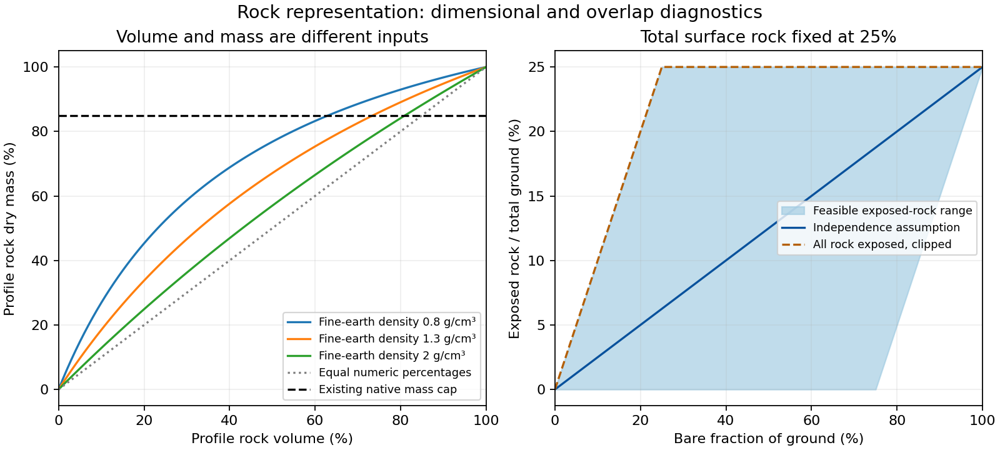

# Volumetric and surface rock: investigation and development findings

## What is established

Rock has at least three independent representations: dry mass within a soil
profile, fragment envelope volume within a profile, and plan-view protection
at the surface. A parameter called rock is insufficient without its denominator,
depth, spatial support, size threshold, time and measurement/source provenance.
The [canonical contract](../../../schemas/rock-fragment-representation-contract.md)
keeps these quantities separate. The two implemented repairs restore dimensional
meaning; neither introduces field-calibrated rock physics.

## Primary evidence

| Source | Established meaning | Limitation for development |
| --- | --- | --- |
| [ISRIC layer metadata](https://docs.isric.org/globaldata/soilgrids/SoilGrids_faqs_01.html) | cfvo is stored volume per mille; divide by10 for volume percent; bdod is normalized separately | Coarse spatial/depth predictions, not engineered road armor |
| [ISRIC bulk-density service](https://maps.isric.org/generated/soilgrids/bdod.html) | Density of the fine-earth fraction | Not whole-mixture or mineral particle density |
| [USDA WEPP correction note](https://www.ars.usda.gov/ARSUserFiles/50201000/WEPP/docs/wepp_rock_correction_issue.pdf) | Correct mass-volume relation uses fine-earth bulk density and fragment density |2.65g/cm3 is a mineral convention, not all lithologies |
| [SSURGO metadata](https://www.nrcs.usda.gov/sites/default/files/2022-08/SSURGO-Metadata-Table-Column-Descriptions-Report.pdf) | Profile sieve fields are weight-based; horizon water contents are whole-soil volume; surface fragment records distinguish cover and kind | Surface fragment definition includes wood and smaller fragments than some erosion-cover guidance |
| [RUSLE2 guide section7.7](https://www.ars.usda.gov/ARSUserFiles/60600505/RUSLE/RUSLE2_User_Ref_Guide.pdf) | Site-specific surface protection and overlap, preferably measured | Soil-survey fragment quantities are not equivalent inputs |
| [Robertson et al.,2021](https://doi.org/10.1016/j.geoderma.2020.114912) | Original sandstone-alluvium measurements show fragments can retain water and affect fine-earth properties | A lithology/site finding; no universal storage correction follows |
| [Cousin et al.,2003](https://www.sciencedirect.com/science/article/pii/S0341816203000377) | Original laboratory measurements distinguish fragment and fine-earth retention | Nonporous dilution alone need not reproduce real stony-soil retention |

These primary sources support definitions and model limitations. They do not
validate a universal relation from profile stoniness to surface cover. Historical
SSURGO water-retention adjustment and native storage conventions need their own
reconciliation, not a literature-derived multiplier selected to improve sediment.

## Consumer and failure-class matrix

| Path | Finding | Disposition |
| --- | --- | --- |
| RUSLE C RAP/SBS | Footprint maximum chose cfvo units; low-valued per-mille rasters became tenfold excessive proxies | Fixed recognized raw/aligned SoilGrids scale; both modes tested |
| RUSLE K | Recognized SoilGrids sources already divide by10 | Preserve; run existing regressions |
| SoilGrids -> ISRICHorizon ->7778 -> WEPP | Volume percent emitted directly into mass RFG | Convert using source fine-earth density; actual raster/build/native readback gate |
| SSURGO RFG | Weight-based sieve preparation already matches mass field | Preserve; prior108 emitted-row audit remains applicable |
| SSURGO retention | Whole-soil volumetric water divided by a capped **mass** fraction complement | Unresolved scientific heuristic; do not label it a correct volume-basis inverse |
| SSURGO chfrags ancillary | Queried averages are not the emitted RFG path | Preserve current behavior; audit any proposed future summation/fragment-kind mapping before use |
| SSURGO surface proxy | Standard summary/parquet path does not produce preferred cosurffrags columns | Do not advertise automatic availability; acquisition/aggregation design still needed |
| BC SIFT COFRAG -> RFG | Direct assignment exists; specific consumed field/density basis not established | Unresolved peer; obtain source-specific dictionary before changing or certifying |
| Native profile CPM/storage | Mass conversion is corrected, but absolute UL and other effective-capacity consumers differ | Separate shared-consumer contract and source scalar gate |
| Native crop cover | Generic residue cover evolves and enters erosion, friction, infiltration | No direct permanent-rock substitute validated |
| Native range cover | Explicit rock cover and spatial partition have separate branches | Do not switch landuse to simulate one crop mechanism |
| Uploaded/legacy soils | Existing author-supplied mass fields and native bounds | No reinterpretation or automatic migration |

BC [field guidance](https://www.env.gov.bc.ca/esd/distdata/ecosystems/Soil_Data/CAPAMP/Documentation/capamp_manual.pdf)
defines coarse fragments volumetrically, making the SIFT assignment a serious
follow-up. This does not by itself prove that a particular SIFT COFRAG record
or its BD field uses the same preparation convention. No class-wide closure is
claimed while this provenance gap remains.

## Executed volumetric investigation

The reproducible dimensional study covers505 combinations of volume0-100% and
fine-earth density0.8,1.0,1.3,1.6,2.0g/cm3. Analytic mass-volume round trips close
to a1e-14 arithmetic bound. The mass inventory is explicit:0.2cm3 of mineral
fragments weighs0.53g;0.8cm3 of fine earth at1.3g/cm3 weighs1.04g. Thus20volume%
is33.75796mass%. Directly labeling20volume% as20mass% implies only10.92437volume%
under the same density convention.

Native one-decimal soil serialization and the85mass% cap are retained. The cap
activates in138 of the505 illustrative grid cells, so corrected input meaning
does not guarantee arbitrary-volume preservation by the engine. Supplied native
density is also bounded to0.8-2.0g/cm3 and may evolve. Exact interpretation must
use the consumed density, computational layer mapping and clock. Do not average
mass percentages, densities and volume fractions interchangeably: conversion is
nonlinear and aggregation should preserve the stocks appropriate to its basis.

The retained586 initialization layers across36 histories were independently read
at SO_SCON_DRY. All satisfy dry <= field capacity <= initialized POR*CPM under
the proposed static nonporous convention. Minimum ceiling-minus-dry margin is
0.05749449 and ceiling-minus-field margin0.03136275, both dimensionless water
fractions. This is a necessary feasibility check only. It does not exercise
freeze/thaw, drainage, overflow, dynamic porosity or later occupied states, and
cannot authorize replacing UL globally.

The current SSURGO retention heuristic divides whole-soil water by
1-min(50,mass_percent)/100. Under the nonporous convention, the inverse would
instead use the fine-earth volume share. Fragment porosity, source density,
native correction and existing bounds must be reconciled together before any
repair. Retention validity cannot be inferred solely from field capacity being
larger than wilting point.

## Executed surface investigation

The36-cell overlap study retains marginal bare fraction B and total rock S.
Their exposed-rock intersection E can range from max(0,B+S-1) to min(B,S).
For B=S=0.5, E can be anywhere from0 to0.5. Independence gives0.25; assuming all
rock exposed gives0.5. Both are compatible with the same marginals, so a single
profile or total-cover estimate cannot identify exposed mineral soil.

Current RUSLE normalization chooses an all-exposed, clipped prior at aggregate
support. It does not establish overlap. Applying one run scalar redistributes
rock in proportion to local bare area; it does not reproduce a road tread,
ditch, fill or forest buffer map. Correcting scale leaves that prior unchanged
and explicitly uncertain. Native crop residue protection must not acquire an
extra rock term until historical generic-cover intent is known, or protection
may be counted twice.

## Development sequence and acceptance

The two unit/basis repairs have deterministic generated-artifact acceptance.
A permanent crop surface-rock mechanism is a separate research deliverable:
identify measured/exposed cover by role; specify overlap with litter/vegetation;
keep the rock state independent of decomposing biomass; map consumers; establish
zero-rock identity and bounded fully covered behavior; then review a private
single-mechanism native implementation. Hydraulic responses may legitimately
change, so validation requires explicit water and sediment accounting rather
than assuming identical runoff. Native capacity reconciliation remains separate.

The next data acquisition design must preserve mapunit/component identifiers,
fragment kind, low/representative/high cover, particle-size support, sampled area,
missing-area fraction, density basis, depth, observation date and uncertainty.
Never add component records without confirming whether their cover classes
partition or overlap. Exclude wood from mineral-rock conversion explicitly.
Field line/point-intercept or classified imagery should retain counting support
and co-located rock/litter/bare labels. No new observations were manufactured
in this investigation.

Production changes apply on rebuild; existing cached artifacts and uploaded
soils remain untouched. The package develops general dimensional support and
specific fixes. It does not declare the Roads magnitude gates passed, complete
native rock physics validated, production deployed, or every regional soil
source reconciled.

## Local development validation

The generated-artifact experiment retains239 hash-bound files:16 actual RUSLE
C raster/manifest cases across both modes, both raw/aligned source paths and
stored cfvo20,100,101,800, plus real SoilGrids extraction and seven generated
soil horizons including the200mm split. Both production conversion functions
also match the independent505-cell mass inventory/inverse checks.

A fresh synthetic16-year native fixture repeats the generated soil over three
OFEs, changing only p1.sol in a copied complete runtime bundle. All978 observer
build members match. Native consumes0.338 mass fraction across30 computational
layers; actual fine-earth fraction is approximately0.7996991 (rock volume
0.2003009), consistent with serialization and observed density. The emitted profile ends at
2,000 mm while native ProfileDepth is 1,800 mm under the existing depth cap; this
uniform-fragment fixture does not demonstrate preservation of the full source
depth. Seven outputs
are fresh, and17,532 daily water records cover all years/days/OFEs. This is
consumer-boundary validation, not complete physical closure.

A bounded live NRCS surface query for only the four development materials timed
out. The exact request and failure are retained without a substitute. Current
surface-fragment rows, their overlap/wood treatment and field applicability are
therefore not validated by this execution.
