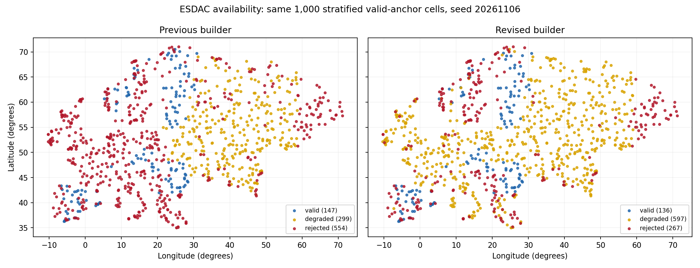

# ESDAC availability and incident replay

Executed 2026-11-06 UTC. Status: locally validated; production deployment and original-run rebuild remain separate.

## Outcome

The same 1,000 sampled locations improved from **446 usable soils (44.6%)** to
**733 (73.3%)**: 287 recovered, zero regressions and identical parsed numerical
parameters for all 446 previous successes. The original 35-hillslope incident
builds all 35 locations, yielding two unique base soils and 35 valid disturbed
conversions. Repeating that batch preserves every existing soil file byte.

| Outcome | Previous builder | Final candidate |
| --- | ---: | ---: |
| Valid without warnings | 147 | 136 |
| Usable with warnings (`degraded`) | 299 | 597 |
| Rejected | 554 | 267 |
| Unexpected exceptions | 0 | 0 |

Eleven previous valid cases now expose missing descriptive information as a
warning; their physical parameters remain identical. Seventy-six final successes
use one material bounded by the existing mapped impermeable depth. All 76
serialize the 200 mm boundary and preserve identical properties across that
material's split rows.

## Sampling frame and limits

Seed 20261106, 1,000 unique valid FAO anchor raster cells distributed across the
existing 20×20 raster strata. The source frame has 10,121,083 valid cells in a
7,500×5,500 raster; nodata cells are excluded. Every selected cell was built,
including source-invalid cells. This is spatially balanced sampling, not an
area-weighted random estimate or a guarantee of universal European coverage.
The installed ESDAC footprint sampled spans 35.012–71.021°N and
10.324°W–71.221°E. Ten-degree geographic bins in the summary are reporting bins,
not the original sampling strata. West of 40°E, 536/746 locations are usable;
east of 40°E, 197/254 are usable. These longitude cuts are descriptive, not
country boundaries.

## Remaining limitations

The 267 rejected locations lack sufficient supported physical evidence.
Diagnostics below overlap: a location may have several source errors. The
builder stops at a failed validation stage, so this is a census of observed
stopping reasons, not of every possible downstream issue at rejected locations.
No profile was filled with generic physical defaults to improve availability.

| Observed error and field | Locations |
| --- | ---: |
| `source.categorical.empty:cec_sub` | 7 |
| `source.categorical.empty:cec_top` | 7 |
| `source.categorical.lookup_failed:esdb` | 20 |
| `source.hydrogrids.all_missing:hydrogrids` | 38 |
| `source.hydrogrids.provider_unavailable:hydrogrids` | 2 |
| `source.il.no_information:il` | 65 |
| `source.stu.bulk_density_nonpositive:STU_EU_S_BD` | 125 |
| `source.stu.bulk_density_nonpositive:STU_EU_T_BD` | 37 |
| `source.stu.mandatory_profile_empty:STU_EU_S_CLAY/SAND/SILT` | 125 |
| `source.stu.mandatory_profile_empty:STU_EU_T_CLAY/SAND/SILT` | 37 |
| `source.stu.provider_unavailable:stu` | 10 |
| `source.stu.texture_balance:STU_EU_S_CLAY/SAND/SILT` | 2 |
| `source.textdepchg.no_information:textdepchg` | 93 |

Missing texture-change or total-depth classes still require physical evidence;
no guessed depth was introduced. Missing subsoil remains fatal when a positive
subsoil interval must actually be emitted. HydroGrids conductivity still must
supply a usable profile. Arbitrary non-string categorical short-code provider
payloads remain outside the real provider contract.

## Evidence chain

`incident_soil_quality.json` retains the original production failure.
`incident-sufficiency.tar.gz` contains the accepted report, actual base and
9002 disturbed soils, per-location parsed readback and a final source-hash/retry
receipt. `availability-sufficiency.tar.gz` contains every sampled outcome and
all 733 accepted base soil files; `availability-baseline.tar.gz` contains the
same manifest's pre-change results and 446 files. `comparison.json` binds the
pair and lists every recovered ID, zero regressions and zero physical changes.
All generated file hashes were independently checked against their receipts.
Full watershed/model execution and production recovery are outside this
soil-builder delivery boundary.

The first metadata-only checkpoint is retained in `availability-final.tar.gz`,
`metadata-comparison.json` and `metadata-availability.*`: it accepted 657/1,000
and exposed the mapped-depth peer defect. That checkpoint's aggregate source
hash flag is false because unused batch code changed during its direct-builder
run; the directly consumed modules matched. The final sufficiency study has
`source_unchanged=true` for all three source files and supersedes that checkpoint
for release evidence.

## Reproduction and identity

Baseline revision: `f77469e41b6e83b0f4ffbf7e6f827a3638a9bf80`.
Candidate changes: `candidate.patch`; exact consumed-source hashes are in both
final summaries. Runtime: forest development `wepppy-rq-worker`, UID 1000,
GID 993, container `6aeecd27417d`, image
`sha256:88a982e44d316824f493c99d0c3a9a3db3e4800feef86ff2c65693677039162b`.
The retained data are local generated-artifact evidence, not a production
installation claim.

From the repository root, in a runtime with the installed ESDAC rasters:

    wctl exec rq-worker python docs/work-packages/20261106_esdac_missing_data/artifacts/run_availability.py --output /tmp/esdac-availability-20261106-baseline --manifest /workdir/wepppy/docs/work-packages/20261106_esdac_missing_data/artifacts/availability-manifest.json --workers 4 --baseline-ref f77469e41b6e83b0f4ffbf7e6f827a3638a9bf80
    wctl exec rq-worker python docs/work-packages/20261106_esdac_missing_data/artifacts/run_availability.py --output /tmp/esdac-availability-20261106-sufficiency --manifest /workdir/wepppy/docs/work-packages/20261106_esdac_missing_data/artifacts/availability-manifest.json --workers 8
    wctl exec rq-worker python docs/work-packages/20261106_esdac_missing_data/artifacts/replay_incident.py /tmp/esdac-incident-20261106-sufficiency
    wctl exec rq-worker python docs/work-packages/20261106_esdac_missing_data/artifacts/summarize_availability.py /workdir/wepppy/docs/work-packages/20261106_esdac_missing_data/artifacts /tmp/esdac-availability-20261106-sufficiency

Runners refuse existing output directories. Use a fresh runtime/directory or
extract the retained archives for read-only re-verification. The summarizer
verifies manifest identity, artifact hashes, previous-success physical parity
and candidate source hashes before writing its comparison/map.

## Validation

Focused tests: 122 passed, plus one later actual-writer collision/reordered-retry
regression passed (123 total distinct focused tests). The shared raster-table
diagnostic sampler was exercised directly against installed data. ADR-date,
document lint, changed broad-exception and test-stub checks pass. Independent
correctness review has no open medium/high finding. Final broad-suite and native
matrix results are recorded in `validation.md` after completion.
