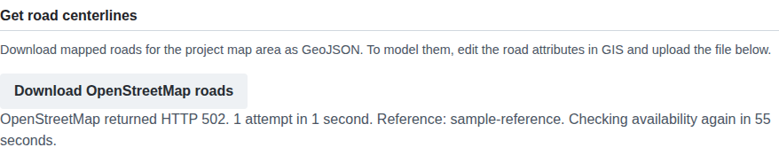

# Roads retry validation

On the Forest development server, an authorized browser clicked Download OpenStreetMap roads. The actual slot endpoint returned unknown (60 seconds). The download endpoint returned 200 about 114 seconds later. Chromium downloaded osm-roads.geojson, and readback verified 369 features with OSM IDs and highway tags. The interpreter request succeeded on the first attempt.

A separate Chromium run on the same rendered control intercepted the upstream-facing application responses to simulate an available slot, HTTP 502, an available slot, and a successful GeoJSON result. After the real 55-second wait, the second download POST succeeded. Chromium downloaded and read back the fixture file and displayed recovery after one failed attempt. This exercises UI recovery under a controlled failure. Independent socket tests exercise real HTTP request and response handling.

The usability reviewer accepted the fieldset layout and identified a premature retry promise at budget exhaustion and a singular-duration grammar issue. Both were corrected and retested. The final rendered control is captured below.

The open-wepp-org review covered the web deployment, HTTPRoute and public egress policy. No production deployment or live Kubernetes acceptance run was performed.
